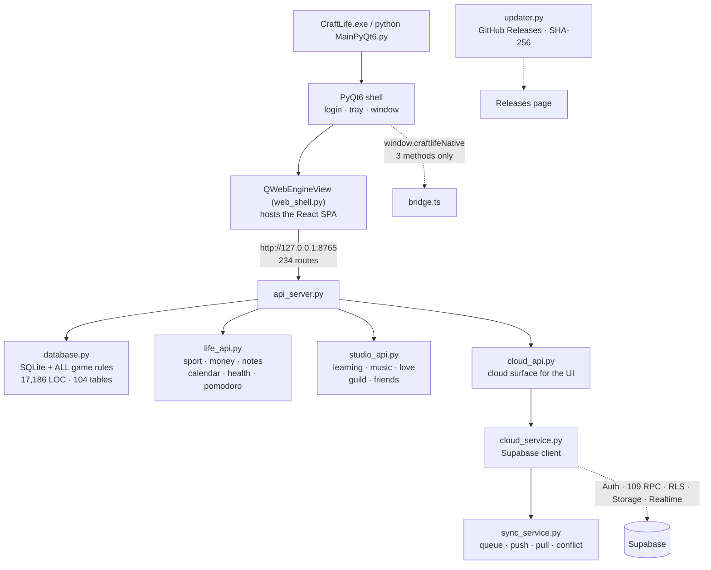
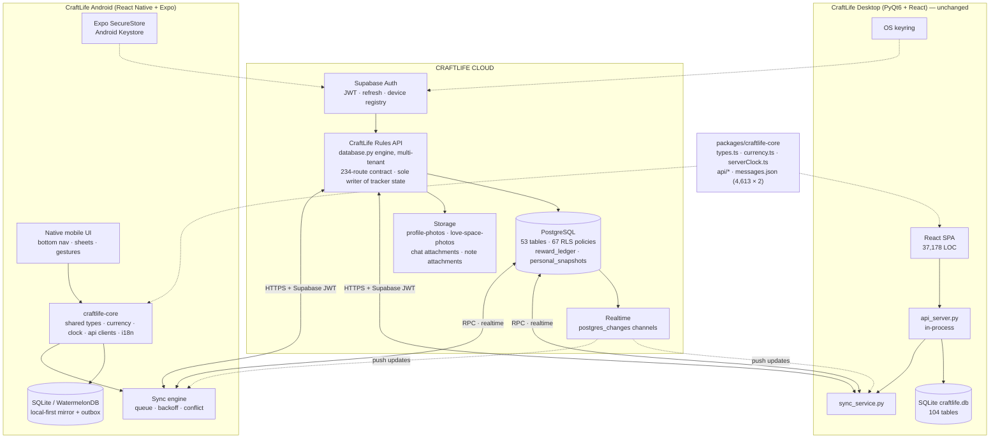

# CraftLife — Phase 0 Audit & Android/Cloud Migration Architecture

**Document type:** Initialization report (Phase 0). No implementation was performed.
**Repo:** `https://github.com/Hellowww-02/CraftLife` @ `a05bda3` (tag `v1.7.4`)
**Audited:** 2026-10-06
**Governing rules:** `UPDATE_RULES.md` (read in full; see §4 below)
**Language policy:** this file is a repository artifact → English, per `UPDATE_RULES.md` §2.

> **Scope guard honoured.** Per the task brief §30, nothing was rewritten, deleted,
> replaced or migrated in this session. The only writes performed were: cloning the
> repo, `npm install` inside `web/` (gitignored), a throwaway SQLite DB in `/tmp`,
> and this document.

---

## 1. Executive Summary

**CraftLife today is not a PyQt6 desktop app that needs converting. It is already a
three-tier, offline-first, cloud-connected product** whose desktop client happens to
be a PyQt6 window hosting a React single-page app.

Measured facts:

| Dimension | Measured |
|---|---|
| Git history | 201 commits, 2026-05-12 → 2026-10-04, 8 release tags (`v1.5.0` → `v1.7.4`) |
| Tracked files | 212, repository size 11 MB |
| Python | `MainPyQt6.py` 25,218 LOC · `database.py` 17,186 · `studio_api.py` 4,620 · `api_server.py` 4,510 · `translations.py` 5,164 · `life_api.py` 1,811 · `cloud_service.py` 970 |
| Frontend | 37,178 LOC TypeScript/TSX across 124 files (87 `.tsx`, 37 `.ts`) |
| Local API | **234 unique routes** across 4 modules |
| Local DB | **104 real tables**, 90 `idx_*` indexes, 138 idempotent `_safe_alter` migrations |
| Cloud | Supabase: **16 migrations, 53 tables, 109 RPC functions, 67 RLS policies** |
| i18n | **4,613 keys × 2 languages** (Indonesian + English), both `messages.json` copies byte-identical |
| Themes | 12 theme identities, 275 `.ct-*` classes, 40 `--ct-*` design tokens |

**The single most important finding:** CraftLife already has an authentication
system, a cloud database, row-level security, storage buckets, realtime channels,
device registration, a sync queue with retry/backoff, optimistic-concurrency
snapshot sync, and a server-authoritative, idempotent, ledger-based economy. The
migration brief's Phase 2 ("Cloud Data Foundation") is therefore **largely already
built** and should be *audited and extended*, not constructed.

**The single biggest risk:** the personal-data sync model is a **whole-document
last-write-wins snapshot**. With one desktop device that is tolerable. The moment a
second active device (Android) exists — which is the entire point of this project —
routine offline edits on two devices will produce conflicts that the current UI
resolves by discarding one side wholesale. **This must be fixed before Android
ships, not after.**

**Verification baseline (all green, run during this audit):**

| Gate (`UPDATE_RULES.md` §7) | Command | Result |
|---|---|---|
| Python syntax | `python -m py_compile api_server.py database.py studio_api.py life_api.py learning_helper.py music_downloader.py translations.py updater.py` | **exit 0** |
| Types | `npx tsc --noEmit` (in `web/`) | **0 errors** |
| Build | `npx vite build` (in `web/`) | **clean**, `index-D6AxbvIC.js` 458.84 kB / 143.84 kB gzip |
| i18n sync | `python3 scripts/export_i18n.py` | **4,613 keys**, `git diff` empty → identical |
| Database (fresh) | `init_db()` against `/tmp` DB | **104 tables**, `PRAGMA integrity_check = ok`, `foreign_key_check` = 0 violations, 1,074 foods / 74 achievements / 23 redeem codes seeded |
| Database (idempotence) | `init_db()` run twice | **no error** (0.23 s then 0.06 s) |
| RLS integrity | policy vs `enable row level security` cross-check | **0 tables with a policy but no RLS**; 0 RLS tables with no policy |

---

## 2. Current Architecture

CraftLife is a **local-first client with an optional cloud backend**, connected by a
loopback HTTP API. The React UI never talks to Supabase.



### Architectural rules the code actually follows (verified, not assumed)

1. **Game logic lives in `database.py` only.** Confirmed: no `supabase.co` reference,
   no `createClient`, no `@supabase` import anywhere in `web/src` — the search
   returned empty. The UI cannot reimplement rules because it never sees the data
   layer. This is `UPDATE_RULES.md` **P2** and it is genuinely enforced.
2. **The desktop↔web coupling is only 3 methods.** `web/src/bridge.ts` exposes
   exactly `pickFile`, `notify`, `openPath`. Everything else is plain HTTP.
   **This is the single most important fact for the Android decision.**
3. **The API base URL is already relocatable.** `apiBase()` in
   `web/src/api/client.ts` resolves from `VITE_API_BASE`, then `?api=`, then
   same-origin. The SPA is not hard-bound to loopback.
4. **Schema migrations are idempotent and non-destructive** (P6): 138 `_safe_alter`
   calls; verified by running `init_db()` twice with no error.
5. **The client never holds a privileged key.** A full-repo scan for
   `service_role|service-role|secret_key|sk-…|sb_secret` found **no live credential** —
   only comments, `env(…)` placeholders in `supabase/config.toml`, and README prose
   forbidding it.

### The one structural tension

`users` (local SQLite) stores `level`, `xp`, `gold`, `gems`, multipliers.
`user_cloud_wallets` (Postgres) stores the same quantities, written only through
`reward_ledger` by `security definer` functions. `cloud_wallet_cache` (local)
mirrors the server value.

So progression numbers have **two authorities**. Today the desktop resolves this by
treating local as authoritative for display and server as authoritative for online
economy operations. That works with one device. With two devices it does not, and
§19 below defines how to close it.

---

## 3. Repository Structure

```text
CraftLife/
├── MainPyQt6.py            25,218 LOC  Desktop shell + legacy Qt fallback pages
├── web_shell.py               541 LOC  QWebEngineView host, download manager
├── api_server.py            4,510 LOC  Local HTTP API (:8765) — 99 route refs
├── life_api.py              1,811 LOC  Sport/money/notes/calendar/health — 67 route refs
├── studio_api.py            4,620 LOC  Learning/music/love/guild/friends — 102 route refs
├── cloud_api.py               555 LOC  Cloud surface for the UI — 15 route refs
├── database.py             17,186 LOC  SQLite schema + ALL game rules (single source of truth)
├── cloud_service.py           970 LOC  Supabase client: auth, RPC, storage, realtime, keyring
├── sync_service.py            545 LOC  Sync engine: queue, push, pull, conflict resolution
├── cloud_config.py                     Cloud configuration loading
├── translations.py          5,164 LOC  4,613 keys × id/en
├── updater.py                 594 LOC  APP_VERSION = "1.7.4"; GitHub Releases + SHA-256
├── learning_helper.py                  Gemini prompts & Studio parameters
├── music_downloader.py                 yt-dlp download engine
├── food_data.py                        1,074-entry bilingual food catalog
├── mathtools.py · holidays.py · applog.py
├── CraftLife.spec                      PyInstaller onedir spec
├── scripts/                            build.ps1 · export_i18n.py · copy_qtwebengine.py
├── web/                                React 18 + Vite 5 + Tailwind 4 + TS — 37,178 LOC
│   ├── src/components/views/           30 view files (24 sidebar destinations + Login/Onboarding/sub-views)
│   ├── src/components/                 shared UI · learning/ · love/ · music/ · notes/ · ui/ · wrapped/
│   ├── src/context/GameContext.tsx     2,240 LOC — global app state
│   ├── src/api/                        client · cloud · life · rpg · studio (typed clients)
│   ├── src/types.ts                      742 LOC — shared TypeScript domain types
│   ├── src/utils/                      currency · serverClock · serverTime · theme · sound · pomoAlarm
│   ├── src/bridge.ts                   3-method native bridge
│   ├── src/index.css                 2,185 LOC — 12 themes, 275 .ct-* classes, 40 tokens
│   └── src/i18n/messages.json          generated (do not edit by hand)
├── supabase/
│   ├── migrations/                     16 numbered migrations
│   ├── functions/                      1 Edge Function: chat-attachment-maintenance
│   ├── tests/                          9 SQL schema tests
│   └── config.toml
└── *.md                                UPDATE_RULES.md + 10 roadmaps/reports
```

**Note:** `web/src/components/views/` contains 30 files but only 24 sidebar
destinations — `BossView`, `EnchantForge`, `NutritionView`, `HealthPomodoroView`,
`PomodoroView`, `LoginView`, `OnboardingWizard` are sub-views or entry screens
reached from other pages. The README's "29 pages" and the v1.7.4 roadmap's "24 view"
figures both refer to this same set from different angles.

---

## 4. Documentation Analysis

| Document | Role |
|---|---|
| **`UPDATE_RULES.md`** | **Highest priority.** Canonical operating procedure. Read in full. |
| `README.md` (27,821 B) | Accurate, current, and unusually honest about limitations |
| `UPDATE_ROADMAP_L01_L10_v1.7.4.md` | Most recent plan; documents the gacha/LED decisions |
| `UPDATE_ROADMAP_A01_A14_v1.6.3.md` (148 KB) | Largest roadmap; per-phase evidence |
| `UPDATE_ROADMAP_H01_H07_v1.7.0.md`, `_I01_I07_v1.7.2`, `_J01_J04_v1.7.2_rev`, `_C01_C09_v1.6.4`, `_P47_P63` | Historical phase plans |
| `UIUX_ROADMAP_U1_U12.md` | "Craft Design System" v2 roadmap — **directly relevant to the Android design system** |
| `FINAL-PARITY-MATRIX.md`, `CRAFTLIFE-PARITY-REPORT.md`, `CRAFTLIFE PHASE 3 FINAL PARITY REPORT.md` | Historical Qt→React parity records |
| `OPERATOR_RELEASE.md` | Release runbook |
| 3 × `*-PHASE-SUMMARY.md` | Consolidated phase reports |

### ✅ Confirmation: `UPDATE_RULES.md` has been read and understood

Read in full (247 lines, 11 sections + Appendix A). The constraints that bind every
future session on this migration, as I understand them:

- **P1 Local-first** — cloud stays optional, never a hard dependency. *Consequence:
  Android must be fully functional offline; the cloud must never become required.*
- **P2 Single source of truth** — game rules in `database.py`, money formatting in
  `web/src/utils/currency.ts`, strings in `translations.py`. **Never create a second
  implementation.** *Consequence: this rule is the dominant constraint on the Android
  architecture and is why §12/§14 below reject any design that ports game rules to
  Kotlin/Dart/TypeScript.*
- **P3 Scope discipline** — change exactly what is asked; report adjacent bugs, don't
  fix them uninvited.
- **P4 Zero regression** — prefer additive changes (new columns, new endpoints,
  optional parameters).
- **P5 Evidence over adjectives** — "fixed" requires command output, counts, hashes.
- **P6 Never lose user data** — idempotent, non-destructive migrations.
- **P7 Bilingual by default** — every user-facing string ships in Indonesian *and* English.
- **P8 Reproducible releases** — one commit phase, one tag, deterministic builds.
- **P9 Toggleable effects** — every ambient/decorative effect needs a Settings toggle,
  persists locally, honours `prefers-reduced-motion`.
- **P10 Single monetization path** — when a system moves acquisition path, remove the
  old entry points from the UI.
- **§2 Language** — chat in **Indonesian**, repository artifacts in **English**.
- **§3 Ten-Point Phase Report** — mandatory every phase.
- **§4 In-chat Formats 1–6** (7 at phase close) — concrete, never "see above".
- **§5 Version anchors** — `updater.py APP_VERSION` and `web/package.json version`
  must always be identical. **Verified both are `1.7.4` today.** Tag `v1.7.4`
  resolves to HEAD `a05bda3` with 0 commits after it — release state is clean.
- **§6 Migration policy** — SQLite automatic via `_safe_alter`; Supabase migrations
  always optional for local-only users.
- **§7 Verification gates** — all reproduced in §1 above.
- **§8 Engineering rules** — partial updates must not clobber; idempotent side
  effects; sanitise input; one formatter; `ct-*` declared without `@layer`;
  accessibility is part of done; no `backdrop-filter` over the animated scene.
- **§9 Hygiene** — never commit `.env`, keys, `craftlife.db*`, `logs/`.
  **⚠️ This rule is currently violated — see §9.1.**
- **§10 Release packaging** — archive contains the *contents* of `dist/CraftLife/`.
- **§11 Handoff checklist** — 9 items.

---

## 5. Current Feature Inventory

Discovered from code, not from the brief's suggested list. 24 sidebar destinations
plus 7 sub/entry views.

| Feature | Current implementation | Key files | DB | Cloud | Category |
|---|---|---|---|---|---|
| Dashboard | React, widgets, count-up, charts | `DashboardView.tsx` (583), `DashboardSummaryPanel`, `DashboardWidgetsDialog`, `charts.tsx` (621) | ✓ derived | — | **SHARE** |
| Profile | React; level/XP/HP/MP/talents/rebirth/titles | `ProfileView.tsx` (721) | `users`, `user_talents` | `profiles`, `user_cloud_wallets` | **CLOUD** (server-authoritative) |
| Habits | Streaks incl. real fail streaks, folders, templates, reorder+undo | `HabitsView.tsx` (433+), `useTaskReorder`, `useDragReorder`, `useUndo` | `habits`, `task_folders`, `task_history` | snapshot | **REFACTOR** (row-level sync) |
| Dailies | Recurring, fail, freeze | `DailiesView.tsx` (433) | `dailies` | snapshot | **REFACTOR** |
| Quests | One-time, folders | `QuestsView.tsx` | `todos` | snapshot | **REFACTOR** |
| SportTrack | Workout log, reps chart | `SportView.tsx` (672) | `sport_activities`, `sport_rep_logs` | snapshot | **REFACTOR** |
| Economy | Income/expense, debts+installments, savings, investments, subscriptions, **budgets** | `EconomyView.tsx` (1,233), `MoneyInput` | `economy_items`, `economy_budgets`, `debts`, `debt_notes`, `savings`, `investments`, `subscriptions` | snapshot | **REFACTOR** |
| Supplies | Inventory in/out/adjust | `SuppliesView.tsx` (405) | `supplies_items`, `supplies_tx` | snapshot | **REFACTOR** |
| Health & Food | 1,074-item bilingual catalog, meals, macros, favourites | `HealthFoodView.tsx` (815), `NutritionView.tsx` (769), `food_data.py` | `food_items`, `food_logs`, `user_food_favorites`, `user_nutrition_goals`, `recipes`, `recipe_items` | snapshot | **REFACTOR** |
| Health logs | Steps, sleep, weight, height, mood, 7-day trends, water | `HealthFoodView.tsx` | `health_logs`, `water_logs`, `user_health_goals`, `user_water_goals` | snapshot | **REFACTOR** |
| Love Space | 6 tabs: overview, plans, memories, connection, cycle, gallery | `LoveSpaceView.tsx` (1,655), `components/love/*` (14 files) | 8 `relationship_*` + 2 `menstrual_*` + `love_*` | **11 `love_space_*` tables + realtime** | **CLOUD** (already server-authoritative) |
| Learning | NotebookLM-style 3-panel shell, 23-type upload, Gemini chat + citations, 12 Studio generators, podcast | `LearningView.tsx` (1,838), `components/learning/*` (11 files), `learning_helper.py`, `mathtools.py` | 7 `learning_*` tables | **none** | **NEEDS INVESTIGATION** (see §9.4) |
| Pomodoro | Global timer, alarm, sessions | `PomodoroView.tsx`, `HealthPomodoroView.tsx`, `pomoAlarm.ts` | `pomodoro_sessions` | snapshot | **REFACTOR** |
| Music | Local library, playlists, downloads (yt-dlp), mini player, synced lyrics | `MusicView.tsx` (933), `components/music/*`, `MusicPlayerContext`, `music_downloader.py` | `playlists`, `playlist_icons`, `song_lyrics`, `music_play_history` | **none** | **NEEDS INVESTIGATION** (§9.5) |
| Notes | Folders, archive, attachments, LaTeX, markdown | `NotesView.tsx` (821), `NoteAttachments` | `notes`, `note_folders`, `note_attachments` | snapshot (attachments **not**) | **REFACTOR** |
| Reminders | Sounds, yearly repeat (29 Feb → 28 Feb) | `RemindersView.tsx` (514) | `reminders` | snapshot (sound_file stripped) | **REFACTOR** + **MOBILE REBUILD** (local notifications) |
| Calendar | Indonesian holidays 2025–2027, day notes | `CalendarView.tsx`, `holidays.py`, `holidaysData.ts` | `calendar_notes` | snapshot | **SHARE** (static data) |
| Crafting | Minecraft-style crafting table | `CraftView.tsx` | `recipes`, `recipe_items` | `cloud_crafts`, `recipes_server` | **SERVER-AUTHORITATIVE** |
| Shop | Category sub-tabs, 10-slot equipment | `ShopView.tsx` (415) | `inventory`, `economy_items` | `shop_items_server`, `cloud_shop_purchases`, `cloud_inventory`, `cloud_inventory_tx` | **SERVER-AUTHORITATIVE** |
| Enchant Forge | Anvil UI, exact buff preview | `EnchantForge.tsx` | `inventory.enchant_level` | `enchant_item_cloud` RPC | **SERVER-AUTHORITATIVE** |
| Pets | Spin gacha, 39 pets, 6 ranks, pity, active skills, training, encyclopedia | `PetsView.tsx`, `data/gameData.ts` | `user_pets`, `pet_spin_state` | **none** | **SERVER-AUTHORITATIVE** (gacha must be server-side) |
| Boss | Solo + guild arena, damage floats, battle log | `BossView.tsx` | `boss_battles`, `boss_rewards`, `custom_bosses` | `online_guild_battles`, `online_guild_boss_actions` | **SERVER-AUTHORITATIVE** |
| Friends | Full chat: attachments, replies, reactions | `FriendsView.tsx` (705) | `friends`, `messages`, `local_message_reactions` | `friendships`, `conversations`, `messages`, `message_reactions`, `message_attachments` + realtime | **CLOUD** (done) |
| Guild | Chat, bosses, roles, transfers, bans | `GuildView.tsx` (947) | `guilds`, `guild_members`, `guild_messages`, `guild_requests`, `guild_invites`, `guild_leader_transfers` | 10 `online_guild_*` tables | **CLOUD** (done) |
| Achievements | 74 definitions, category chips, claimable glow | `AchievementsView.tsx` | `achievements`, `user_achievements`, `food_achievements` | `achievement_definitions`, `claim_achievement_reward_cloud` | **SERVER-AUTHORITATIVE** |
| Leaderboard | Top-3 podium | `LeaderboardView.tsx` | local derived | `get_global_productivity_leaderboard`, `get_online_guild_leaderboard` | **CLOUD** (done) |
| PvP | Challenges, scoring, rewards | via Guild/Friends | `pvp_challenges` | `online_pvp_challenges`, `online_pvp_rewards`, `pvp_score` | **CLOUD** (done) |
| Settings | Themes, font scale, contrast, sound, LED toggle, export/import, DB self-care, cloud config | `SettingsView.tsx` (864) | `users.*`, `maintenance_state` | `notification_preferences`, `cloud_devices` | **REFACTOR** (split device vs account prefs) |
| Login / Onboarding | Local login, lockout, backup codes, app lock; onboarding wizard | `LoginView.tsx`, `OnboardingWizard.tsx` | `users`, `user_sessions`, `backup_codes` | Supabase Auth | **REFACTOR** |
| Command Palette | Ctrl+K, ↑↓/Enter, Ctrl+1–9 | `CommandPalette.tsx` | — | — | **MOBILE REBUILD** (search sheet) |
| Year Wrapped | Report in user's currency | `YearWrappedDialog.tsx`, `wrappedUtils.ts` | derived | — | **SHARE** |
| Notifications | Bell, unread badge, history | `ToastContainer`, navbar | `notifications` | `social_notifications`, `notification_preferences` | **REFACTOR** + push |
| Auto-update | GitHub Releases, SHA-256, countdown | `updater.py` (594), `UpdateDialog` | — | `app_releases`, `latest_app_release` | **DEPRECATE on Android** (Play Store / OTA) |

**Categories used:** KEEP · REFACTOR · SHARE · CLOUD · MOBILE REBUILD ·
SERVER-AUTHORITATIVE · DEPRECATE · NEEDS INVESTIGATION.
**Nothing was deleted during this audit.**

---

## 6. Database Analysis

### 6.1 Current schema (measured)

- **104 real tables** in a fresh database. Source contains 105 `CREATE TABLE IF NOT
  EXISTS` statements; the extra one is `playlists_new`, a migration scratch table
  renamed to `playlists` at `database.py:1618` and `:1643`. Not a defect.
- **90 `idx_*` indexes**; **110 `FOREIGN KEY` clauses**; **138 `_safe_alter`**
  idempotent column migrations.
- `PRAGMA integrity_check` → `ok`. `PRAGMA foreign_key_check` → **0 violations**.
- Seeds verified on a fresh DB: **1,074** `food_items`, **74** `achievements`,
  **23** `redeem_codes`.
- Fresh `init_db()` completes in **0.23 s**; a second run in **0.06 s** with no error.

### 6.2 Sync coverage — the real parity gap

| Bucket | Tables | Notes |
|---|---:|---|
| In `tracker_v1` snapshot (`EXPORT_TABLES`) | **40** | The personal-data sync payload |
| Social/cloud-path (entity map + realtime) | **14** | `friends`, `couple_relationships`, `messages`, `guild*`, `pvp_challenges`, `love_*`, `user_profile_photos` |
| Infra / cache / auth | **18** | `sync_queue`, `cloud_*`, `user_sessions`, `backup_codes`, `maintenance_state`, `trash_bin` |
| **No cloud path at all** | **33** | See below |

**The 33 unsynced tables** — these will silently not exist on Android unless planned for:

```text
achievements          activity_log          boss_battles          boss_rewards
chat_attachments_cache  custom_bosses       debt_notes            food_achievements
inventory             learning_audio        learning_chats        learning_chunks
learning_generations  learning_notebooks    learning_notes        learning_sources
local_message_reactions  love_album_items   love_albums           music_play_history
note_attachments      notifications         pet_spin_state        playlist_icons
playlists             playlists_new(*)      redeem_code_redemptions  redeem_codes
song_lyrics           user_achievements     user_pets             user_talents
users
```
(*) `playlists_new` is migration scratch and never persists.

Grouped by what it means:

- **RPG progression (must become server-authoritative, not synced):**
  `user_pets`, `pet_spin_state`, `user_talents`, `user_achievements`,
  `achievements`, `food_achievements`, `boss_battles`, `boss_rewards`,
  `custom_bosses`, `inventory`, `redeem_code_redemptions`, `users`.
  These are exactly the tables §17 of the brief says must never be client-trusted.
  Today a second device would each keep an independent pet collection.
- **Learning module (7 tables) — device-local, large binary-adjacent.** Needs a
  deliberate decision, not an accident.
- **Music (4 tables) — references local filesystem paths.** Cannot sync as-is.
- **`note_attachments` — BLOBs.** Deliberately excluded from the snapshot
  (`build_cloud_personal_snapshot` docstring: "BLOB/media and credentials are
  excluded"). Correct decision; needs a Storage-bucket counterpart for Android.
- **`debt_notes` — genuine gap.** `debts` syncs, its notes do not. Likely an
  oversight; report, do not fix uninvited (P3).
- **`notifications`, `activity_log`, `local_message_reactions`** — derived/cache,
  correctly unsynced.

### 6.3 Problems found

| # | Problem | Severity | Evidence |
|---|---|---|---|
| D1 | `database.py` is a **17,186-line single module** holding schema, migrations, game rules, import/export and cloud snapshot logic | **High** | `wc -l` |
| D2 | `users` holds `level/xp/gold/gems` locally **and** `user_cloud_wallets` holds them server-side → dual authority | **High** | `database.py:15527 save_cloud_wallet`, `reward_ledger` migration |
| D3 | **8 MB hard cap** on the personal snapshot, enforced both client-side (`_sanitize_cloud_personal_snapshot`) and server-side (`payload_too_large`) | **Medium** | A heavy user with years of `food_logs` + `task_history` + `activity_log` will hit it, and sync then fails wholesale |
| D4 | Local integer PKs are remapped on import (`apply_cloud_personal_snapshot` re-baselines the hash after import) — entity identity is not stable across devices | **Medium** | comment at `apply_cloud_personal_snapshot` |
| D5 | `debt_notes` not in `EXPORT_TABLES` while `debts` is | **Low** | §6.2 |
| D6 | No soft-delete/tombstone convention across the 40 synced tables (32 `deleted_at`-ish references total, concentrated in cloud cache tables) → deletes cannot propagate reliably under row-level sync | **High** (blocks §19) | grep count |
| D7 | `playlists` was rebuilt via a `_new` table rename twice (lines 1592 and 1628) — migration history is layered, not linear | **Low** | grep |

---

## 7. Online / Backend Analysis

**CraftLife already has a substantial, well-engineered cloud layer.** This is not a
greenfield.

### 7.1 What exists

| Capability | Status | Evidence |
|---|---|---|
| Authentication | ✅ Supabase Auth; `sign_up`, `sign_in`, `restore_session`, `sign_out` | `cloud_service.py:139–213` |
| Session persistence | ✅ Refresh token in **OS keyring** (`keyring`, service `"CraftLife Supabase"`) with graceful degradation when unavailable | `cloud_service.py:36–49, 169–193` |
| User accounts / profiles | ✅ `profiles` + `handle_new_auth_user` trigger + `current_profile_active()` guard | initial migration |
| PostgreSQL | ✅ **53 tables** across 16 migrations | §1 |
| Row-level security | ✅ **53 tables RLS-enabled, 67 policies**; cross-check found **no table with a policy but no RLS**, and none RLS-enabled with no policy | verified |
| RPC | ✅ **109 `security definer` functions** | verified |
| Storage | ✅ 2 private buckets (`profile-photos`, `love-space-photos`) + chat attachments, owner-scoped policies, WebP conversion at max 1600 px / q84 | `_as_webp`, bucket policies |
| Realtime | ✅ Postgres-changes channel with reconnect counter, dedicated thread, clean unsubscribe | `cloud_service.py:818–866`, `sync_service.py:58` |
| Devices / sessions | ✅ `cloud_devices` with `revoked_at`, rename, revoke-one, revoke-others, security-event notifications | `register_cloud_device`, `revoke_other_cloud_devices` |
| Online social | ✅ Friends + chat (attachments/replies/reactions), couple link, guilds (roles/bans/transfers), PvP, leaderboards, notification centre | 10 `online_guild_*` tables |
| Server-authoritative economy | ✅ **Yes, and it is good** — see §7.2 | `reward_ledger` migration |
| Image uploads | ✅ Upload slots, attachment maintenance Edge Function, usage quota RPC | `create_chat_attachment_upload_slot` |
| Remote configuration | ✅ App releases + `latest_app_release` | `app_updates` migration |
| Sync engine | ✅ Queue with retry/backoff, entity map, device state, conflict status | §17 below |

### 7.2 The economy is genuinely server-authoritative

This deserves emphasis because it is the hardest part of §17 and it is **already done**:

- `reward_ledger` is append-only: `unique(user_id, idempotency_key)`, a `source`
  `CHECK` whitelist (`productivity|pvp|guild_boss|achievement|quest|shop_refund|admin_adjustment`),
  `reversal_of` self-reference, and `check (delta_xp <> 0 or delta_gold <> 0 or delta_gems <> 0)`.
- `spend_gold` re-reads the balance and raises `insufficient_balance` — the client
  cannot assert a purchase.
- `record_productivity_event` enforces: idempotency-key dedupe; a **time window**
  (`> now()+5 min` or `< now()-14 days` → `invalid_event_time`); **one event per
  source per day** for `habit`/`daily`/`sport`; quest uniqueness; pomodoro daily caps.
- Level is derived server-side: `wallet_level_for_xp = greatest(1, floor(sqrt(xp/100))+1)`.
- Admin reversal is explicitly gated: `admin_reverse_ledger` raises `admin_only`
  unless `current_setting('role') = 'service_role'`.

**Conclusion:** the anti-cheat foundation the brief asks for already exists. The
Android client must be built to *use* it, and the remaining client-trusted systems
(pets/gacha, talents, achievements claiming, local boss battles) must be moved onto it.

### 7.3 The snapshot RPC is well built

`upsert_personal_snapshot` validates `auth.uid()`, profile-active state,
`base_revision >= 0`, `content_hash ~ '^[0-9a-f]{64}$'`, payload ≤ 8 MB, and
**requires the calling device to be registered and not revoked**. It takes
`SELECT … FOR UPDATE` on the row, returns `revision_mismatch` with the current remote
snapshot on conflict, and is idempotent on identical `content_hash` (no phantom
revision). Client-side, `cloud_personal_snapshot_hash` canonicalises row order before
hashing so query-plan differences don't create phantom revisions.

The mechanism is sound. **The granularity is the problem** — see §19.

---

## 8. React / Web Analysis

### 8.1 Why it exists and how complete it is

The React app is **the production UI**, not an experiment. It reached full parity
with the legacy Qt pages in v1.4.0 ("Full Parity Release") and was rebuilt as the
"Craft Design System" in v1.5.0. The legacy Qt pages survive only as a fallback via
`CRAFTLIFE_WEB_UI=0`.

Maturity evidence: 37,178 LOC; `tsc --noEmit` **0 errors**; clean Vite build;
per-view code splitting (initial JS reduced 1,614 → 458.84 kB); bilingual error
boundaries per view and at root; focus traps; `prefers-reduced-motion` handling;
4,613 i18n keys in two languages with zero divergence between the two
`messages.json` copies.

### 8.2 What transfers to Android

| Asset | Reusable? | Notes |
|---|---|---|
| `web/src/types.ts` (742 LOC domain types) | ✅ **Directly** | The single most valuable portable artifact |
| `web/src/utils/currency.ts` | ✅ **Directly** | P2 mandates one formatter — must be shared, not rewritten |
| `web/src/api/*` client shape (234 typed routes) | ✅ **Directly** | `apiBase()` already relocatable |
| `web/src/i18n/messages.json` (4,613 × 2) | ✅ **Directly** | Plain JSON; any i18n runtime can consume it |
| `web/src/utils/serverClock.ts` / `serverTime.ts` | ✅ **Directly** | Server-clock "today" + midnight rollover — critical for streaks |
| `web/src/data/*` (gameData, mathSymbols, holidaysData, liveCatalog) | ✅ **Mostly** | Static catalogs |
| `web/src/hooks/*` (useUndo, useDragReorder, useTaskReorder, useFocusTrap, useEscapeClose) | ⚠️ **Logic yes, DOM no** | Reorder/undo logic ports; the DOM event handling does not |
| `web/src/components/charts.tsx` (621 LOC custom SVG) | ⚠️ **Reimplement** | SVG-based; needs a native chart lib, but the *spec* (tooltip flip, clamp) transfers |
| `web/src/index.css` (12 themes, 275 classes, 40 tokens) | ⚠️ **Tokens yes, CSS no** | The token *values* become the Android theme; the CSS does not |
| `web/src/components/views/*` (30 files, ~20k LOC) | ❌ **Rebuild** | DOM + Tailwind + CSS custom properties; no DOM on native |
| `web/src/bridge.ts` | ✅ **Trivially** | Only 3 methods to reimplement natively |

### 8.3 Known issues in the web layer

- `authToken()` reads the token from a **`?token=` URL query parameter** and copies
  it into `sessionStorage` (`web/src/api/client.ts:9–24`). Tokens in URLs leak via
  history, logs and `Referer`. Acceptable for a loopback WebEngine; **not acceptable
  on Android** — see §20.3.
- `GameContext.tsx` is **2,240 LOC** in a single context — a state-management
  refactor is advisable before a second consumer exists.
- `LearningView.tsx` (1,838) and `LoveSpaceView.tsx` (1,655) are large single files.
- **Zero automated frontend tests** (see §9.6).

---

## 9. Technical Debt

### 9.1 `.env` is committed to the repository — violates `UPDATE_RULES.md` §9

**Confirmed:** `git ls-files | grep env` → `.env`. It is tracked even though
`.gitignore` lists `.env` / `.env.*`, because it was committed before the ignore rule
existed (`.gitignore` does not untrack already-tracked files).

Contents (4 keys): `SUPABASE_URL` (a real `*.supabase.co` project reference),
`SUPABASE_PUBLISHABLE_KEY` (47 chars, `sb_pub…` prefix), `CRAFTLIFE_CLOUD_ENABLED`,
`CRAFTLIFE_SYNC_INTERVAL_SECONDS`.

**Severity: Low–Medium, not Critical.** A full-repo scan found **no service-role or
secret key anywhere** — only comments, `env(…)` placeholders in
`supabase/config.toml`, and README prose forbidding it. The publishable/anon key is
*designed* to be public, and RLS is correctly enabled on all 53 tables (§7.1), so no
privileged access is exposed. But it does violate the project's own §9, exposes the
project reference, and contradicts the README's "Never commit your `.env`".

**Recommended fix (not applied — P3):** `git rm --cached .env`, add `.env.example`,
rotate the publishable key as a precaution, and note the rotation in the release
runbook per §10.6.

### 9.2 Monolithic Python modules

`MainPyQt6.py` 25,218 LOC and `database.py` 17,186 LOC. `database.py` alone mixes
schema definition, 138 migrations, all game rules, import/export, and cloud snapshot
serialisation. Any server-side reuse of the rules engine (§14) requires carving it
into packages first.

### 9.3 Duplicated "cloud" concepts

Local `cloud_*` cache tables mirror server tables one-for-one
(`cloud_inventory_cache` ↔ `cloud_inventory`, `cloud_wallet_cache` ↔
`user_cloud_wallets`, `cloud_guild_messages_cache` ↔ `online_guild_messages`, …).
This is a reasonable offline cache, but the naming and the absence of a single
repository abstraction means a second client will re-derive the mapping.

### 9.4 Learning module is entirely device-local

7 `learning_*` tables, Gemini integration, multi-file upload with originals kept,
generated audio. **No cloud path.** On Android this either stays device-local (and
the user loses their notebooks when they change phone) or needs a Storage + metadata
design. This is a product decision, not a technical one — flagged for the maintainer.

### 9.5 Music is filesystem-bound

`playlists` stores absolute local paths; `music_downloader.py` uses `yt-dlp`;
`music_play_history` records `path`. Android's scoped storage makes absolute paths
meaningless across devices. Needs a media-store/content-URI abstraction before any
Android work.

### 9.6 No automated tests anywhere in Python or the frontend

Verified: `find` for `test_*.py` / `*_test.py` → **none**; `find web -name "*.test.*"`
excluding `node_modules` → **none**. Only **9 Supabase SQL schema tests** exist in
`supabase/tests/`. `UPDATE_RULES.md` §7 refers to "harnesses" that are run ad-hoc and
**not committed**, so regression protection is not reproducible.

**This is the highest-impact debt for a migration of this size.** Every §7 gate that
isn't `py_compile`/`tsc`/`vite build` currently depends on human memory.

### 9.7 Documentation drift (minor)

- `README.md:289` states "**17 migrations**"; the directory contains **16**.
- README's docs table links several files not present in this tree
  (`RELEASE_NOTES_v1.7.4.md`, `OPERATOR_RELEASE_v1.7.4.md`,
  `2026-09-23-C01-C09-PHASE-SUMMARY.md`, …). Per §9 they may be intentionally
  release-only, but the links are dead in-repo.
- Version anchors are **correct**: `APP_VERSION = "1.7.4"` (`updater.py:147`) and
  `web/package.json` `"version": "1.7.4"` match, as §5 requires.

---

## 10. Android Migration Assessment

### What can be reused

1. **The entire cloud backend** — 53 tables, 109 RPCs, 67 RLS policies, 2 storage
   buckets, realtime, auth, device registry. Reuse and extend (per the brief §5).
2. **`web/src/types.ts`, `currency.ts`, `serverClock.ts`, `serverTime.ts`, `api/*`
   client contracts, and all 4,613 × 2 i18n strings.**
3. **The design token set** — 40 `--ct-*` values × 12 themes become the Android theme.
4. **The sync primitives** — `sync_queue` (retry_count/next_retry_at/last_error),
   `cloud_entity_map`, `cloud_device_state`, and the backoff pattern are the right
   shape and should be mirrored on Android rather than reinvented.
5. **The server-authoritative economy** — use it as-is.

### What must be rebuilt

1. **All 30 views** as native mobile UI (§10/§24 of the brief; no DOM on native).
2. **Navigation** — 24-item sidebar → bottom navigation + grouped "more" + deep links.
3. **Charts** — custom SVG → native charting, preserving the tooltip-flip/clamp spec.
4. **Reminders/notifications** — local notifications + FCM, replacing
   `bridge.notify` and the in-process alarm.
5. **File picking and media** — replacing `bridge.pickFile` and absolute paths with
   SAF/MediaStore/content URIs.
6. **Token storage** — keyring → Android Keystore / EncryptedSharedPreferences.
7. **Game rules** — *must NOT be rebuilt* (P2). See §14.

### The hard constraint

`database.py` is **17,186 lines of Python**. Android cannot run it. Therefore:

- Porting the rules to Kotlin/Dart/TypeScript **violates P2** and creates exactly the
  "second implementation" the rules forbid — and guarantees desktop/Android drift.
- Embedding CPython on Android (Chaquopy/BeeWare) is technically possible but adds
  tens of MB, native-build fragility, and Play-policy risk, and still leaves
  `database.py`'s SQLite-file assumptions to untangle.
- **The correct answer is to move the rules engine server-side** and have both
  clients call it. The HTTP boundary already exists: 234 routes in `api_server.py`.

---

## 11. Mobile Framework Comparison

Evaluated against the actual codebase, not against popularity.

| Criterion | **Flutter** | **React Native (Expo)** | **Kotlin / Compose** | **WebView / Capacitor** |
|---|---|---|---|---|
| Reuse of 37,178 LOC React UI | ❌ none (Dart rewrite) | ⚠️ logic/types/utils yes, views no | ❌ none | ✅ ~all (but see UX) |
| Reuse of `types.ts` (742 LOC) | ❌ re-declare in Dart | ✅ **identical** | ❌ re-declare in Kotlin | ✅ |
| Reuse of `currency.ts` (P2 one-formatter) | ❌ duplicate → **P2 risk** | ✅ **shared package** | ❌ duplicate → **P2 risk** | ✅ |
| Reuse of 4,613 × 2 i18n JSON | ✅ (any runtime) | ✅ **native fit** | ✅ | ✅ |
| Native mobile UX (§10/§24) | ✅ excellent | ✅ excellent | ✅ **best** | ❌ desktop-shaped — **fails brief §10** |
| Offline-first SQLite | ✅ drift/sqflite | ✅ WatermelonDB / op-sqlite | ✅ Room | ⚠️ via native plugin |
| Realtime (Supabase) | ✅ | ✅ | ✅ | ✅ |
| Secure token storage | ✅ flutter_secure_storage | ✅ Expo SecureStore (Keystore) | ✅ Keystore | ⚠️ |
| Push (FCM) | ✅ | ✅ Expo Notifications | ✅ | ⚠️ |
| Image/file handling (SAF) | ✅ | ✅ expo-document/media-library | ✅ | ⚠️ |
| Charts / animation | ✅ strong | ✅ strong (Skia/Reanimated) | ✅ | ✅ (existing SVG) |
| Testing | ✅ | ✅ | ✅ | ⚠️ |
| Team's existing skill (TS/React) | ❌ new language | ✅ **same language** | ❌ new language | ✅ |
| Future iOS (§11 requirement) | ✅ | ✅ | ❌ **Android-only** | ⚠️ |
| OTA updates | ⚠️ Shorebird | ✅ **Expo Updates** | ❌ | ✅ |
| Long-term maintainability | ✅ | ✅ | ✅ | ❌ |

### Rejected options and why

- **Flutter** — would discard all TypeScript expertise, `types.ts`, `currency.ts`
  (forcing a second money formatter → **direct P2 violation**), the API client
  contracts and the hooks' logic. Highest parity cost of the four.
- **Kotlin / Jetpack Compose** — best raw fidelity, but **zero reuse** and
  **Android-only**, which fails the brief's "Potential iOS support" criterion.
- **WebView / Capacitor hosting the existing React app** — technically the cheapest
  and it would reuse ~everything, but it fails the brief's §10 and §24 head-on
  ("Do not force desktop UX onto Android", "Avoid desktop-like tables, overloaded
  dashboards"). It would also still need the local Python API replaced. Rejected on
  product grounds, not technical ones. *Worth noting: because `bridge.ts` is only 3
  methods and `apiBase()` is already relocatable, a WebView proof-of-concept is a
  cheap **risk-reduction spike** even though it is not the shipping answer.*

---

## 12. Recommended Android Technology

# → **React Native with Expo (TypeScript)**

**Reasoning, in priority order:**

1. **It is the only option that satisfies `UPDATE_RULES.md` P2.** P2 forbids a second
   implementation of shared logic. With TypeScript, `types.ts`, `currency.ts`,
   `serverClock.ts`, `serverTime.ts`, the 234-route API client contracts and the
   4,613 × 2 i18n catalogue become a **shared package consumed by both the web and
   the Android app**. Every other native option duplicates the money formatter and
   the domain types, which is precisely the failure mode P2 exists to prevent.
2. **The team already writes this stack.** 37,178 LOC of React/TypeScript is in
   production and passing `tsc --noEmit` with 0 errors. Flutter and Kotlin both
   require a new language *and* a new UI paradigm simultaneously.
3. **It delivers genuinely native mobile UX** (brief §10/§24) — bottom navigation,
   bottom sheets, gestures, pull-to-refresh, predictive back — unlike WebView.
4. **Expo covers the specific platform needs this app has**: SecureStore (Keystore)
   to replace the desktop keyring, Notifications/FCM to replace `bridge.notify`,
   document/media-library pickers to replace `bridge.pickFile` and absolute music
   paths, and **OTA updates** — which matters because `updater.py`'s GitHub-Releases
   self-update model is not viable under Play Store policy.
5. **iOS later at low marginal cost**, satisfying the brief's scalability criterion.

**Explicit non-goal:** React Native does **not** mean porting the React *views*. The
views are DOM + Tailwind + CSS custom properties and must be rebuilt as native
components (§10 of this report). What transfers is the **contract layer** — types,
API clients, formatting, clock, i18n — which is the part P2 actually governs.

**Concrete first step implied:** extract `web/src/types.ts`, `utils/currency.ts`,
`utils/serverClock.ts`, `utils/serverTime.ts` and `api/*` into a
`packages/craftlife-core` workspace package consumed by both apps. That single move
makes P2 enforceable by the compiler instead of by convention.

---

## 13. Backend Comparison

| Criterion | **Supabase (current)** | Firebase | Custom Node/Nest + Postgres | Self-hosted PostgREST |
|---|---|---|---|---|
| Already integrated | ✅ **16 migrations, 53 tables, 109 RPCs, 67 policies** | ❌ full rebuild | ❌ full rebuild | ❌ full rebuild |
| Auth with refresh + device sessions | ✅ in use | ✅ | ⚠️ build it | ⚠️ build it |
| Row-level security | ✅ **in use, verified clean** | ⚠️ rules, weaker model | ⚠️ app-level | ✅ |
| Server-side transactional rules (plpgsql `security definer`) | ✅ **109 already written** | ❌ Functions, no SQL transactions | ✅ | ✅ |
| Realtime | ✅ **in use** | ✅ | ⚠️ build it | ❌ |
| Object storage with owner-scoped policies | ✅ **in use** | ✅ | ⚠️ build it | ❌ |
| Idempotent ledger economy | ✅ **already built** | ❌ rebuild | ❌ rebuild | ❌ rebuild |
| Local-first fit (P1) | ✅ client stays offline-capable | ✅ | ✅ | ✅ |
| Migration risk | **Lowest** | Highest | High | High |

**Supabase is not "automatically correct" — it was evaluated and it wins on
evidence.** The decisive factor is that the hard 20% (ledger-based anti-cheat
economy, RLS ownership model, device registry, storage policies, realtime channels)
is **already written, already migrated, and already passing schema tests**. Switching
platforms would discard ~2 years of accumulated backend work to gain nothing.

**The one thing Supabase alone does not solve** is P2: 17,186 LOC of Python game
rules cannot live in plpgsql without a risky, slow rewrite that would fork the rule
set from the desktop client.

---

## 14. Recommended Backend

# → **Keep Supabase, and add a hosted CraftLife Rules API in front of the personal-data domain**

Two planes, one authority each:

| Plane | Technology | Owns | Status |
|---|---|---|---|
| **Identity + social + economy + files + realtime** | **Supabase** (Auth, Postgres, RLS, 109 RPCs, Storage, Realtime) | accounts, devices, friends, chat, guilds, PvP, love space, leaderboards, wallet/ledger, shop, craft, enchant, photos | ✅ **Exists — extend, don't rebuild** |
| **Personal tracker domain + game rules** | **Hosted CraftLife Rules API** — the existing `api_server.py` + `database.py`, refactored to be multi-tenant and Postgres-backed, authenticated by **Supabase JWT** | habits, dailies, quests, sport, economy records, health, nutrition, notes, calendar, reminders, supplies, pets, talents, achievements | 🔨 **New — but it is a refactor of code that already exists** |

**Why this shape and not the alternatives:**

- *Move all rules into plpgsql RPC* → rejected. Rewriting 17,186 LOC of Python into
  SQL is slower and riskier than containerising it, and any divergence silently
  breaks P2 and P4.
- *Let Android call Supabase directly for personal data* → rejected. It would force
  the rules into TypeScript, duplicating `database.py` → **P2 violation**, and would
  make XP/gold client-computed → **brief §17 violation**.
- *Embed CPython in the Android app* → rejected (§10).
- **Chosen:** the rules stay in **one** Python implementation. Desktop keeps calling
  it in-process (unchanged, zero regression — P4). Android calls the same code over
  HTTPS. The server verifies the Supabase JWT, scopes every query to `auth.uid()`,
  and is the sole writer of progression state.

**Deployment:** a single containerised service (FastAPI or the existing
`http.server`-based `api_server.py` modernised) behind Supabase's JWT, with Postgres
as its store. Supabase remains the identity provider, so RLS still guards every
direct table access and the Rules API is the only writer of tracker tables.

**Migration of `database.py` is incremental, not big-bang:** the 234-route surface
already separates domains (`api_server`, `life_api`, `studio_api`, `cloud_api`), so
domains can be lifted one at a time behind the same contract the desktop already uses.

---

## 15. Target Architecture



**What changed versus the brief's §12 diagram:** the brief shows clients syncing
directly to "Database / Storage / Realtime". The audit shows that is unsafe for
personal data because the rules live in Python. The added **Rules API** tier is the
only material change, and it exists solely to protect `UPDATE_RULES.md` P2 and the
brief's §17.

---

## 16. Data Architecture

### Local (per device)

| Layer | Desktop | Android |
|---|---|---|
| Primary store | SQLite `craftlife.db`, 104 tables | SQLite via WatermelonDB/op-sqlite |
| Identity | local `users.id` integer PK | local row id + **client-generated UUID** for every syncable row |
| Credentials | OS keyring | Expo SecureStore / Keystore |
| Media | absolute filesystem paths | MediaStore / content URIs |
| Outbox | `sync_queue` (retry_count, next_retry_at, last_error) | same shape |
| ID mapping | `cloud_entity_map` | same shape |
| Device record | `cloud_device_state` | same shape |
| Cloud caches | 13 `cloud_*` cache tables | same pattern |

### Cloud (Supabase)

| Class | Examples | Writer |
|---|---|---|
| Identity | `profiles`, `cloud_devices`, `auth.users` | Supabase Auth + Rules API |
| Progression (server-authoritative) | `user_cloud_wallets`, `reward_ledger`, `cloud_inventory`, `cloud_shop_purchases`, `cloud_crafts`, `achievement_definitions` | **RPC only** (`security definer`) |
| Social (server-authoritative + realtime) | `friendships`, `conversations`, `messages`, `online_guild_*`, `online_pvp_*`, `love_space_*` | RPC + RLS |
| Personal tracker | habits, dailies, quests, sport, economy, health, notes, reminders, supplies | **Rules API only** |
| Files | `profile-photos`, `love-space-photos`, chat attachments, note attachments | Storage + RLS |
| Backup/versioning | `personal_snapshots`, `personal_snapshot_versions` | RPC |
| Remote config | `app_releases`, `notification_preferences` | operator + RPC |

### Data classification (brief §4)

| Class | Data |
|---|---|
| **Local-only** | themes, font scale, high contrast, sound, LED toggle, app lock, Gemini key, music file paths, `music_play_history`, `activity_log`, `notifications` cache, `trash_bin`, `maintenance_state` |
| **Cloud-suitable / must sync** | the 40 snapshot tables + `debt_notes` (gap) + `note_attachments` via Storage |
| **Must be realtime** | chat, guild chat, presence, typing, PvP, guild boss, leaderboards, notifications |
| **Must be server-authoritative** | XP, gold, gems, level, purchases, crafting, enchanting, gacha/pets, talents, achievement claims, streak rewards, boss rewards |
| **Derived (recompute, never sync)** | leaderboard positions, streaks, budgets' spend tracking, connection score, dashboard widgets, Year Wrapped |

---

## 17. Synchronization Architecture

### 17.1 What exists today (verified)

```text
Android/Desktop change
        │
        ▼
local SQLite ──────────► sync_queue (status, retry_count, next_retry_at, last_error)
        │                        │
        │                        ▼
        │              _process_queue (30 jobs/batch, backoff honoured unless forced)
        │                        │
        ▼                        ▼
build_cloud_personal_snapshot ──► upsert_personal_snapshot RPC
   (40 tables, ≤8 MB)               SELECT … FOR UPDATE
        │                           base_revision check
        ▼                           content_hash idempotence
cloud_personal_sync_state ◄──────── revision_mismatch → conflict
   (remote_revision, remote_hash,
    conflict_status, local_backup_payload)
```

Social data takes a **different, better path**: entity-level, via
`cloud_entity_map` (local_id ↔ cloud_id) plus realtime postgres_changes.

### 17.2 The defect

**Personal data uses whole-document last-write-wins.** Scenario:

```text
Desktop offline: completes Habit A        Android offline: logs 3 meals
        │                                          │
        ▼                                          ▼
  snapshot rev 5                             snapshot rev 5
        └──────────── both push ───────────────────┘
                          │
                          ▼
        second push gets revision_mismatch → conflict_status = needs_resolution
                          │
              ┌───────────┴───────────┐
              ▼                       ▼
   resolve_keep_local          resolve_use_cloud
   (Android's 3 meals          (Desktop's Habit A
    are discarded)              completion is discarded)
```

`resolve_personal_conflict_use_cloud` calls
`apply_cloud_personal_snapshot` → `import_tracker_data(..., preserve_progress=True)`,
which **replaces** the covered tables. The losing side survives only inside
`local_backup_payload`. With one device this is rare; with two devices editing
different things it becomes routine, and the user experiences it as data loss.

The mitigation exists (`local_backup_payload`, 10 archived
`personal_snapshot_versions`) but it is a **recovery** mechanism, not a merge.

### 17.3 Target sync design

**Keep the mechanism, change the granularity.** Three channels:

| Channel | Data | Strategy |
|---|---|---|
| **A. Event log (append-only)** | `food_logs`, `water_logs`, `health_logs`, `task_history`, `pomodoro_sessions`, `sport_activities`, `sport_rep_logs`, `supplies_tx`, `activity_log` | **Union merge** by client-generated UUID + `idempotency_key`. Never LWW. This covers the majority of row volume and is conflict-free by construction. |
| **B. Entity sync (mutable rows)** | `habits`, `dailies`, `todos`, `notes`, `note_folders`, `task_folders`, `economy_items`, `economy_budgets`, `debts`, `savings`, `investments`, `subscriptions`, `recipes`, `reminders`, `calendar_notes`, `relationship_*` | **Row-level 3-way merge.** Per-row `uuid`, `rev`, `updated_at`, `deleted_at`. Client sends `(uuid, base_rev, changed_fields)`; server merges per field. Extend the **existing `cloud_entity_map`** pattern — it already works for social. |
| **C. Server-authoritative commands** | XP, gold, gems, purchases, craft, enchant, gacha, achievements, boss, PvP | **Never synced — issued as RPC commands.** Already built (`record_productivity_event`, `buy_shop_item`, `spend_gold`, …). Client renders results; it never computes them. |

**Retention of the snapshot channel:** `personal_snapshots` and
`personal_snapshot_versions` are **kept**, demoted from primary transport to
(1) initial device migration/import, (2) periodic full backup, (3) disaster
recovery. This is additive and satisfies P4 (zero regression) and P6 (never lose data).

**Prerequisites (must land before Channel B):**

1. Client-generated **UUID primary keys** on all syncable tables (today they are
   `INTEGER PRIMARY KEY AUTOINCREMENT` and are remapped on import — §6.3 D4).
2. **Tombstones**: `deleted_at` + `rev` on every syncable table so deletions
   propagate (today only a handful of tables have `deleted_at` — §6.3 D6).
3. Per-row `rev`/`updated_at` with a server-side `set_updated_at` trigger
   (the trigger already exists in the migrations and can be reused).
4. Split the 8 MB ceiling problem by making the payload incremental rather than whole.

---

## 18. Offline Strategy

**Principle (P1): the app is a local-first app that can sync. It is never an online
app that degrades.**

| State | Behaviour |
|---|---|
| **Online** | Read local cache → render immediately → refresh from server in background. Writes apply locally **and** enqueue. |
| **Offline** | Full read/write against the local store. Every mutation lands in the outbox. Progression actions that require the server (purchase, spin, claim, boss) are **explicitly disabled with a clear reason**, never silently faked — consistent with the README's "No fake success". |
| **Reconnecting** | Drain the outbox in dependency order (folders → tasks → history), honouring `next_retry_at` backoff. Idempotency keys make replays safe. |
| **Conflict** | Auto-merge where the data class permits (Channels A and B). Escalate to the user only for genuine same-field concurrent edits, showing **both** values — never a silent discard. |
| **Sync status** | Always visible: last-synced time, pending count, failed count, and a manual "Sync now" that forces retry past backoff (this behaviour already exists in `_process_queue`). |

**Reuse, don't reinvent:** `sync_queue`'s `status`/`retry_count`/`next_retry_at`/
`last_error` columns and `reset_sync_backoff` are the correct design and should be
mirrored on Android verbatim.

**Android-specific:** outbox draining on `CONNECTIVITY_CHANGE` via WorkManager,
battery-aware deferral, and a foreground-service-free design so background sync never
requires a persistent notification.

---

## 19. Conflict Strategy

Different data classes get different strategies — deliberately.

| Data | Strategy | Rationale |
|---|---|---|
| **XP, gold, gems, level** | **Server-authoritative, event-sourced** | Already implemented. Client sends `record_productivity_event`; server computes deltas into `reward_ledger` and derives level via `wallet_level_for_xp`. The brief's "Desktop XP=500 / Android XP=520" scenario **cannot arise**, because neither device stores the authoritative value. |
| **Purchases, crafting, enchanting, gacha, achievement claims, boss/PvP rewards** | **Server-authoritative + idempotency key** | Already implemented (`unique(user_id, idempotency_key)`, `insufficient_balance`, `admin_only` gate). |
| **Append-only logs** (food, water, health, history, sessions, reps, supplies tx) | **Union merge** | Commutative and idempotent by UUID. Two devices logging different meals both survive. No conflict is possible. |
| **Mutable entities, different fields** (Desktop renames a habit; Android changes its XP value) | **Field-level 3-way merge** | Per-field `base_rev` comparison; both edits apply. |
| **Mutable entities, same field** (both rename the same habit offline) | **Last-write-wins by server timestamp, with the loser preserved** | Keep the existing `local_backup_payload` idea but at row granularity, and surface it in a "recently overwritten" list rather than requiring a blocking dialog. |
| **Deletions vs edits** (Desktop deletes a note; Android edits it) | **Delete wins, edit preserved as a recoverable revision** | Matches the existing `trash_bin` affordance. |
| **Counters that must not double-count** (daily habit completion, pomodoro cap) | **Server-side uniqueness** | Already enforced: one event per `source_local_id` per day, quest uniqueness, pomodoro caps. |
| **Preferences** | **Split scope** | Theme, font scale, sound, LED, app lock → **per device**. Language, notification prefs, currency → **per account**. Today these are conflated in `users.*`. |
| **Social / Love Space** | **Server-authoritative + realtime** | Already implemented; no change. |

**Anti-pattern explicitly rejected:** silent whole-document LWW — the current
personal-sync behaviour. It violates P6 in spirit even though it technically keeps a
backup.

---

## 20. Security Model

### 20.1 What is already correct (verified, not assumed)

- ✅ **No privileged key on any client.** Full-repo scan for
  `service_role|service-role|secret_key|sk-…|sb_secret` → no live credential.
- ✅ **RLS is complete and consistent:** 53 tables RLS-enabled, 67 policies,
  **zero** tables with a policy but no RLS, **zero** RLS tables with no policy.
- ✅ **Storage is private and owner-scoped:** `profile-photos` and
  `love-space-photos` policies bind to `auth.uid()` and to
  `(storage.foldername(name))[1]`; images are re-encoded to WebP at max 1600 px,
  quality 84 before upload.
- ✅ **Desktop refresh tokens live in the OS keyring**, never in the DB or config.
- ✅ **Local passwords** use PBKDF2-HMAC-SHA256 with salt, plus lockout, backup
  codes and optional app lock.
- ✅ **Device-bound writes:** `upsert_personal_snapshot` refuses any device not
  present and unrevoked in `cloud_devices`.
- ✅ **Economy cannot be forged:** ledger uniqueness, balance re-read, event time
  window, per-day dedupe.
- ✅ **Snapshot input is whitelisted** before reaching dynamic SQL:
  `_sanitize_cloud_personal_snapshot` validates the table set against
  `EXPORT_TABLES`, validates columns against live `PRAGMA table_info`, and caps at 8 MB.

### 20.2 Findings requiring action

| # | Finding | Severity | Action |
|---|---|---|---|
| S1 | `.env` tracked in git (§9.1) | **Low–Med** | `git rm --cached .env`; add `.env.example`; rotate publishable key; document in the runbook |
| S2 | Auth token passed as a **`?token=` URL query parameter** into `sessionStorage` (`web/src/api/client.ts:9–24`) | **Medium** | Replace with a bridge-injected handshake or `postMessage`. **Must not be carried to Android** — WebView URLs are logged |
| S3 | **No automated tests** (0 Python, 0 frontend, 9 SQL) | **High** | Establish a committed test suite before the migration; see §23 Phase 1 |
| S4 | Progression dual authority (`users` vs `user_cloud_wallets`) | **Med–High** | Define reconciliation (§16); Rules API becomes sole writer |
| S5 | Rules API will be internet-facing (today `api_server.py` binds loopback) | **High** (new risk) | Supabase JWT verification on every route, per-user query scoping, rate limiting, no `debug` endpoints, audit logging |
| S6 | 8 MB snapshot cap can hard-fail sync for heavy users | **Medium** | Incremental payloads (§17.3) |

### 20.3 Target security model

```text
Android ──(1) email+password──► Supabase Auth ──► access + refresh token
   │                                                     │
   │  refresh token → Expo SecureStore (Android Keystore, hardware-backed)
   │  access token  → memory only, never in URL, never in logs
   │
   ├──(2) Bearer JWT──► Rules API ──► verify signature + exp + aud
   │                                   └──► scope every query to auth.uid()
   ├──(3) Bearer JWT──► Supabase RPC (security definer) ──► RLS + auth.uid()
   └──(4) signed upload slots ──► Storage (private buckets, owner-scoped policies)
```

Rules:
- Privileged credentials exist **only** server-side. No service-role key ever ships.
- Every table access is guarded by RLS **and** by `auth.uid()` scoping in the Rules API.
- Every mutating economy operation carries an idempotency key.
- Uploads go through signed slots with size and MIME limits, then are re-encoded.
- Chat is **not** end-to-end encrypted (already disclosed in the README) — keep
  disclosing it on Android.
- Device registry stays the revocation surface: users can see and revoke devices,
  and revocation must immediately block snapshot writes (already enforced).

---

## 21. Design System Strategy

### 21.1 The five skills and exactly when each is used

| Skill | Repo (verified live, HTTP 200) | Used for | When |
|---|---|---|---|
| **UI/UX Pro Max** | `nextlevelbuilder/ui-ux-pro-max-skill` (133,349★, Python) | **Primary** mobile UI/UX architecture, design system, accessibility, typography, responsive behaviour, interaction design, mobile patterns | Every Android screen, from first component |
| **Taste** | `Leonxlnx/taste-skill` (92,845★, JS) | Visual quality, distinctiveness, avoiding generic AI UI, composition, hierarchy — **preserving CraftLife identity** | Every visual decision; the guard against "generic template" |
| **Impeccable** | `pbakaus/impeccable` (77,066★, JS) | UI **audit and critique** after implementation: polish, responsive, a11y, interaction quality | As a **reviewer**, after each major UI milestone — never as a generator |
| **Awesome Design MD** | `VoltAgent/awesome-design-md` (119,680★) | Design **documentation**: the `DESIGN.md` that records CraftLife's design system and decisions | Once, then maintained as decisions change |
| **Playwright CLI** | `microsoft/playwright-cli` (13,811★, JS) | Web UI regression testing | **Desktop/web only.** Not forced into native Android, where Detox/Maestro are appropriate |

**Conflict resolution rule:** UI/UX Pro Max wins on *structure and accessibility*;
Taste wins on *visual judgement*; Impeccable only ever critiques, never generates, so
it cannot contradict the other two. Playwright is scoped out of native Android
entirely (per the brief §21).

**Continuity note:** the v1.7.4 roadmap already records that **UI/UX Pro Max is
skill repo #6 in active use**, with its pre-delivery checklist already wired into the
gate (contrast ≥ 4.5:1, `focus-visible`, `prefers-reduced-motion`, resilient text
without clipping, `cursor-pointer`). This is not a new introduction — the Android
work **continues** an established practice, and `UPDATE_RULES.md` P9 (toggleable
effects) came out of it.

### 21.2 Extracting the existing CraftLife visual language

Measured from `web/src/index.css` (2,185 LOC):

**12 theme identities:** `modern_dark` (default), `modern_light`, `overworld`,
`nether`, `the_end`, `ocean`, `ancient_city`, `sakura`, `desert`, `sunflower`,
`royal`, `graphite`.

**40 `--ct-*` design tokens.** Core values from `:root` / `modern_dark`:

| Token | Value | Android equivalent |
|---|---|---|
| `--ct-primary` | `#8b5cf6` | `colorPrimary` |
| `--ct-light` | `#a78bfa` | `colorPrimaryContainer` |
| `--ct-bg` | `#0b0b16` | `colorSurface` (dark) |
| `--ct-bg2` | `#14122c` | `surfaceVariant` |
| `--ct-bg3` | `#0c1a26` | `surfaceContainerHigh` |
| `--ct-panel` | `rgba(26,28,50,0.90)` | elevated surface |
| `--ct-border` | `rgba(150,140,255,0.22)` | `outlineVariant` |
| `--ct-accent` / `2` / `3` | `#22d3ee` / `#8b5cf6` / `#22d3ee` | `colorSecondary` / `colorTertiary` |
| `--ct-glow` | `#a78bfa` | emphasis / progress |
| `--ct-text` | `#eef0ff` | `colorOnSurface` |
| `--ct-muted` | `#9b9fc4` | `colorOnSurfaceVariant` |
| `--ct-t1/t2/t3` | text / 88% mix / muted | 3-level text hierarchy |
| `--ct-r-sm…2xl` | `0.625 / 0.875 / 1.125 / 1.375 / 1.625 rem` | 10 / 14 / 18 / 22 / 26 dp radius scale |
| `--ct-ease` | `cubic-bezier(0.22, 1, 0.36, 1)` | standard easing curve |
| `--ct-t-fast`, `--ct-ease-spring`, `--ct-ease-inout` | motion tokens | Motion spec |
| `--ct-font-sans` | Segoe UI Variable Text → Inter → Roboto → system | **Roboto** on Android (already 3rd in the stack) |
| `--ct-font-display` | Segoe UI Variable Display | display typeface |
| `--ct-font-mono` | Cascadia Code → Consolas → JetBrains Mono | mono for numbers |
| `--ct-elev-1/2/3`, `--ct-elev-glow` | elevation scale | Material elevation |
| `--ct-amb-*`, `--ct-scene-*`, `--ct-vignette-o`, `--ct-grain-o`, `--ct-nlm-*` | ambient/scene/NotebookLM tokens | **gate behind the P9 toggle** |

**275 `.ct-*` component classes** covering cards, buttons, inputs, nav, progress
bars, XP indicators, quest cards, achievement cards, avatars, badges, charts, empty
states, loading skeletons, error states, dialogs, toasts, `.ct-led-*` (ambient LED)
and `.ct-sig-*` (per-page signatures).

**Important architectural note:** `UPDATE_RULES.md` §8.5 records that `ct-*` classes
are declared **without `@layer`** specifically so they beat Tailwind utilities. On
Android there is no cascade — this becomes a plain component library with explicit
props, which actually *removes* a class of bug. The `is-row` / `is-sm` modifier
convention (§8.5) should be preserved as component variants.

### 21.3 Design system approach

1. **Write `DESIGN.md`** (Awesome Design MD) recording tokens, type scale, spacing,
   radius, elevation, motion, component inventory, and the *reasons* — before any
   large-scale Android UI (brief §23).
2. **Extract tokens to a shared JSON** consumed by both the web CSS and the Android
   theme, so the 12 themes stay in lockstep instead of drifting.
3. **Preserve what works** — the per-page SignatureKit identity and the theme system
   are distinctive and are exactly what Taste exists to protect. Do **not** flatten
   them into Material defaults.
4. **Re-express, don't copy** — desktop's information density, hover states, context
   menus and keyboard shortcuts become mobile cards, long-press, bottom sheets and
   gestures. Same identity, different grammar.
5. **Ambient effects (LEDs, scene FX) ship behind the P9 toggle** and honour
   `prefers-reduced-motion` / Android's "Remove animations".
6. **Audit with Impeccable** after each milestone; the v1.7.4 gate checklist
   (contrast ≥ 4.5:1, visible focus, reduced-motion, no text clipping) carries over
   verbatim, plus 48 dp minimum touch targets.

---

## 22. Feature Parity Matrix

Built from the discovered implementation. ✓ = full · ◐ = partial · — = not applicable
· ⛔ = intentionally excluded.

| Feature | Desktop | Android | Backend | Sync | Realtime | Offline | First-wave |
|---|:--:|:--:|:--:|:--:|:--:|:--:|:--:|
| Dashboard | ✓ | target ✓ | ✓ derived | ✓ | Optional | ✓ | **1** |
| Profile | ✓ | target ✓ | ✓ | ✓ | Optional | ✓ | **1** |
| Habits | ✓ | target ✓ | ✓ | ✓ (row-level) | Optional | ✓ | **1** |
| Dailies | ✓ | target ✓ | ✓ | ✓ (row-level) | Optional | ✓ | **1** |
| Quests | ✓ | target ✓ | ✓ | ✓ (row-level) | Optional | ✓ | **1** |
| SportTrack | ✓ | target ✓ | ✓ | ✓ | Optional | ✓ | 2 |
| Health & Food | ✓ | target ✓ | ✓ | ✓ | — | ✓ | 2 |
| Health logs / water | ✓ | target ✓ | ✓ | ✓ | — | ✓ | 2 |
| Economy | ✓ | target ✓ | ✓ | ✓ | — | ✓ | 2 |
| Supplies | ✓ | target ✓ | ✓ | ✓ | — | ✓ | 3 |
| Notes | ✓ | target ✓ | ✓ | ✓ | — | ✓ | 3 |
| Note attachments | ✓ | target ✓ | Storage | ✓ (files) | — | ◐ cached | 3 |
| Reminders | ✓ | target ✓ | ✓ | ✓ | — | ✓ (+local notif) | 3 |
| Calendar | ✓ | target ✓ | static | ✓ | — | ✓ | 3 |
| Pomodoro | ✓ | target ✓ | ✓ | ✓ | — | ✓ | 3 |
| Crafting | ✓ | target ✓ | ✓ | ⛔ (command) | — | ◐ | 4 |
| Shop | ✓ | target ✓ | ✓ | ⛔ (command) | — | ◐ | 4 |
| Enchant Forge | ✓ | target ✓ | ✓ | ⛔ (command) | — | ◐ | 4 |
| Pets (gacha) | ✓ | target ✓ | **needs build** | ⛔ (command) | Optional | ◐ | 4 |
| Boss | ✓ | target ✓ | ✓ | ⛔ (command) | ◐ | ◐ | 4 |
| Achievements | ✓ | target ✓ | ✓ | ⛔ (command) | — | ◐ | 4 |
| Friends + chat | ✓ | target ✓ | ✓ | ✓ | **✓** | ◐ | 5 |
| Guild | ✓ | target ✓ | ✓ | ✓ | **✓** | ◐ | 5 |
| PvP | ✓ | target ✓ | ✓ | ✓ | **✓** | ◐ | 5 |
| Leaderboard | ✓ | target ✓ | ✓ | ✓ | **✓** | cached | 5 |
| Love Space | ✓ | target ✓ | ✓ | ✓ | Optional | ◐ | 5 |
| Notifications | ✓ | target ✓ | ✓ | ✓ | **✓** | ◐ | 5 |
| Settings (account) | ✓ | target ✓ | ✓ | ✓ | — | ✓ | 1 |
| Settings (device) | ✓ | target ✓ | — | ⛔ per-device | — | ✓ | 1 |
| Command Palette | ✓ | ⛔ → search sheet | — | — | — | ✓ | 6 |
| Year Wrapped | ✓ | target ✓ | derived | ✓ | — | ✓ | 6 |
| Learning | ✓ | **decision needed** | **none** | **none** | — | ✓ | 7 |
| Music | ✓ | **decision needed** | **none** | **none** | — | ✓ | 7 |
| Auto-update | ✓ | ⛔ Play Store / OTA | ✓ `app_releases` | — | — | — | — |
| Legacy Qt pages | ✓ fallback | ⛔ | — | — | — | — | — |

**Reading the matrix:** "First-wave" is the recommended build order, not a promise.
Rows marked **decision needed** (Learning, Music) are genuinely undecided because the
audit found no cloud path and real platform obstacles (§9.4, §9.5) — these need a
product decision from the maintainer before any engineering estimate is honest.

---

## 23. Migration Roadmap

Adapted from the brief's 12 phases **after** the audit. Two structural changes:
Phase 2 shrank dramatically (the cloud already exists) and a new Phase 1 exists
because the sync model must be fixed before a second device can safely exist.

### Phase 0 — Repository Audit ✅ **COMPLETE (this document)**
Understand the current system. No implementation.

### Phase 1 — Foundations & De-risking  *(new; the real first phase)*
- Extract `packages/craftlife-core`: `types.ts`, `currency.ts`, `serverClock.ts`,
  `serverTime.ts`, `api/*` contracts, `messages.json`. **Makes P2 compiler-enforced.**
- Add UUID PKs + `rev` + `updated_at` + `deleted_at` to syncable tables
  (additive `_safe_alter`, so P4/P6 hold).
- **Establish the missing test suite** (0 Python, 0 frontend today): DB harness,
  API contract tests, sync engine tests, and a committed CI gate reproducing §7.
- Fix S1 (`.env`) and S2 (token in URL).
- Correct the README's "17 migrations" → 16.
- **Exit criterion:** the desktop app is unchanged in behaviour, and a second
  simulated device can merge offline edits without losing either side.

### Phase 2 — Sync Engine Upgrade  *(was the biggest risk; now front-loaded)*
- Implement Channels A (union merge) and B (row-level 3-way merge) per §17.3.
- Demote `personal_snapshots` to backup/import/recovery (kept, not removed — P4).
- Server-side field merge; conflict surfacing that never silently discards.
- Cross-device tests: concurrent edits, offline→online both directions, device
  replacement, reinstall, account recovery.

### Phase 3 — Rules API (Cloud Foundation)
- Containerise `api_server.py` + `database.py` as a multi-tenant service.
- Supabase JWT verification, `auth.uid()` scoping on every query, rate limiting.
- Postgres-backed store; lift domains incrementally along the existing 4-module split.
- Desktop keeps its in-process path — **zero regression**.

### Phase 4 — Desktop Cloud Integration
- Point the desktop at the Rules API for cloud-linked accounts; local-only users
  stay 100% offline (P1).
- Reconcile `users` ↔ `user_cloud_wallets` (closes S4).
- Configure Cloud dialog gains device list + conflict history.

### Phase 5 — Android Foundation
- Expo project, navigation (bottom nav + "more" + deep links), theme from the
  extracted tokens, `craftlife-core` wired in.
- Local SQLite + outbox mirroring `sync_queue`'s shape; SecureStore auth.
- `DESIGN.md` written; UI/UX Pro Max structure; Taste review.

### Phase 6 — Core Features (parity wave 1)
Dashboard · Profile · Habits · Dailies · Quests · Settings.

### Phase 7 — Trackers (waves 2–3)
SportTrack · Health & Food · Health logs · Economy · Supplies · Notes (+ attachments
via Storage) · Reminders · Calendar · Pomodoro.

### Phase 8 — RPG & Server-Authoritative (wave 4)
Shop · Crafting · Enchant · **Pets gacha (move server-side — currently unsynced and
client-trusted)** · Boss · Achievements.

### Phase 9 — Social (wave 5)
Friends + chat · Guild · PvP · Leaderboard · Love Space · Notifications + FCM push.

### Phase 10 — Offline / Reliability Hardening
Backoff, battery-aware WorkManager sync, cache eviction, retry UX, conflict recovery
UI, 8 MB ceiling removal via incremental payloads.

### Phase 11 — Full Parity Verification
Desktop ↔ Android ↔ Cloud comparison against §22; every row evidenced.

### Phase 12 — QA
Performance (cold start, memory, battery, realtime listener count), security (S1–S6
re-check), accessibility (contrast ≥ 4.5:1, 48 dp targets, TalkBack, reduced motion),
regression via the committed suite. **Impeccable audit runs here.**

### Phase 13 — Release
Play Store build, `DESIGN.md` final, `RELEASE_NOTES`, operator runbook
(`OPERATOR_RELEASE_vX.Y.Z.md` per §10.7), version anchors bumped in both places (§5).

---

## 24. Risk Register

| ID | Risk | Sev | Likelihood | Impact | Mitigation |
|---|---|:--:|:--:|---|---|
| **R1** | **Whole-document LWW sync loses data once a second device exists** | **High** | **High** | Silent loss of habits/meals/notes | Phase 1–2 before any Android release; keep `local_backup_payload` as recovery |
| **R2** | **No automated tests** (0 Python, 0 FE) → regressions invisible during a large refactor | **High** | **High** | Broken desktop, undetected | Phase 1 builds the suite *first*; commit the §7 harnesses |
| **R3** | `database.py` 17,186 LOC monolith resists safe extraction | **High** | Medium | Phase 3 slips badly | Lift one domain at a time along the existing 4-module boundary; never big-bang |
| **R4** | Porting game rules to TypeScript/Kotlin → **P2 violation** and permanent drift | **High** | Medium | Two rule sets, divergent XP/gold | Hard architectural rule: rules stay in one Python engine (server-side) |
| **R5** | Rules API becomes internet-facing (today loopback-only) | **High** | Medium | Unauthorised data access | JWT verification + `auth.uid()` scoping on **every** route; RLS as second line; rate limits; security review before exposure |
| **R6** | 33 unsynced tables surface as "missing features" on Android | **Med** | **High** | Perceived data loss, rework | §6.2 inventory is the checklist; each table gets an explicit KEEP/SYNC/SERVER decision |
| **R7** | Local `users` vs `user_cloud_wallets` dual authority | **Med–High** | Medium | Wrong XP/gold shown | Phase 4 reconciliation; server as sole writer |
| **R8** | 8 MB snapshot cap hard-fails sync for heavy users | **Med** | Medium | Sync stops entirely | Incremental payloads (Phase 10); raise cap only as a stopgap |
| **R9** | `.env` committed | **Low–Med** | **Certain** | Project ref + publishable key public; violates §9 | `git rm --cached`, `.env.example`, rotate key |
| **R10** | Auth token in URL query param | **Med** | **Certain** | Token leakage via logs/history | Bridge handshake; never carry to Android |
| **R11** | Learning module has no cloud path; 7 tables device-local | **Med** | Medium | User loses notebooks on device change | Product decision required before estimating |
| **R12** | Music is absolute-path/filesystem-bound; yt-dlp unavailable on Android | **Med** | **High** | Feature unusable on Android | MediaStore/content-URI abstraction; or scope Music out of v1 |
| **R13** | 30 views ≈ 20k LOC of UI to rebuild natively | **Med** | **High** | Schedule | Wave ordering (§22); shared `craftlife-core` reduces per-screen cost |
| **R14** | Desktop regression while adding cloud integration | **Med** | Medium | Breaks the shipping product | P4 additive-only; local-only path untouched; regression suite |
| **R15** | i18n divergence between 3 consumers (web, Android, server messages) | **Low–Med** | Medium | Missing/untranslated strings | Keep `translations.py` as the single source; `export_i18n.py` emits all consumers; CI equality check |
| **R16** | Design drift: Android looks generic, loses CraftLife identity | **Med** | Medium | Product feels like a different app | Taste as reviewer on every milestone; `DESIGN.md` as the contract |
| **R17** | Pets gacha is client-trusted and unsynced | **Med** | **High** | Trivially exploitable; two collections per user | Move server-side in Phase 8, reusing the ledger pattern |
| **R18** | Play Store policy vs `updater.py` self-update model | **Low** | **High** | Rejection | Android uses Play Store + Expo OTA; `updater.py` stays desktop-only |

---

## 25. Recommended First Implementation Phase

**Do not start with the Android app.** Everything downstream depends on two things
that do not exist yet: a shared contract package and a sync model that survives two
devices.

### Build this first: **Phase 1 — `craftlife-core` + row-level sync prerequisites + the missing test suite**

Concretely, in order:

1. **`packages/craftlife-core`** — move `web/src/types.ts` (742 LOC),
   `utils/currency.ts`, `utils/serverClock.ts`, `utils/serverTime.ts` and the
   `api/*` client contracts into a workspace package; re-point `web/` at it.
   *Why first:* it is additive, low-risk, immediately makes **P2 enforceable by the
   compiler**, and every later Android screen depends on it. It also proves the
   monorepo tooling before an Android app exists to complicate it.
2. **The test suite** — commit the §7 harnesses: fresh-DB + legacy-DB schema tests,
   `init_db()` idempotence, API contract tests for the 234 routes, and sync-engine
   tests. *Why here:* R2 is the highest-likelihood/high-severity risk, and every
   subsequent phase is a refactor. Testing after the fact is how this migration fails.
3. **Additive schema prep** — `_safe_alter` to add client UUID, `rev`, `updated_at`,
   `deleted_at` to the 40 snapshot tables + `debt_notes`. No behaviour change, no
   data loss (P4/P6), and it unblocks Phase 2.
4. **Two hygiene fixes** — `git rm --cached .env` + `.env.example` (R9), and remove
   the `?token=` URL path (R10). Correct README's "17 migrations" → 16.

**Explicitly deferred:** the Expo project, any native UI, the Rules API container,
and any change to the personal snapshot transport. Those are Phases 2, 3 and 5, and
starting them now would build on a sync model that is known to lose data (R1).

**Why this ordering is safe under `UPDATE_RULES.md`:** every item is additive (P4),
loses no user data (P6), keeps the app fully functional offline (P1), creates no
second implementation of anything (P2), and is verifiable with the §7 gates plus new
committed tests (P5).

---

## Appendix A — Verification evidence log

Every number in this document came from a command run against `a05bda3` on 2026-10-06.

| Claim | Command | Result |
|---|---|---|
| Python compiles | `python -m py_compile api_server.py database.py studio_api.py life_api.py learning_helper.py music_downloader.py translations.py updater.py` | exit 0 |
| 0 type errors | `cd web && npx tsc --noEmit` | exit 0, no output |
| Clean build | `cd web && npx vite build` | ✓ built in 6.36 s; `index-D6AxbvIC.js` 458.84 kB / gzip 143.84 kB |
| i18n identical | `python3 scripts/export_i18n.py` then `git diff` | `keys=4613`; diff empty |
| Fresh DB | `init_db()` on `/tmp/dbtest/fresh.db` | 104 tables; `integrity_check=ok`; 0 FK violations; 1,074 foods / 74 achievements / 23 redeem codes; 0.23 s |
| Idempotence | `init_db()` twice | 0.23 s then 0.06 s, no error |
| Table count | `grep -c "CREATE TABLE" database.py` | 105 statements → 104 tables (`playlists_new` is scratch) |
| Migration count | `grep -c "_safe_alter" database.py` | 138 |
| Sync coverage | set algebra over `EXPORT_TABLES` vs `CREATE TABLE` | 40 snapshot / 14 social / 18 infra / 33 none |
| API routes | `grep -hoE '"/api/[a-z0-9_/\-{}.]+' api_server.py life_api.py studio_api.py cloud_api.py \| sort -u \| wc -l` | 234 |
| Supabase surface | `grep` over `supabase/migrations/*.sql` | 16 migrations · 53 tables · 109 RPCs · 67 policies · 53 RLS-enabled |
| RLS consistency | policy-set vs RLS-enabled-set cross-check | 0 policy-without-RLS; 0 RLS-without-policy |
| No secret key | `grep -rniE "service_role\|secret_key\|sk-[A-Za-z0-9]{20}\|sb_secret"` | no live credential |
| `.env` tracked | `git ls-files \| grep -i env` | `.env` (violates §9) |
| Version anchors | `grep APP_VERSION updater.py`; `web/package.json` | both `1.7.4` |
| Tag placement | `git rev-parse v1.7.4^{commit}` vs `HEAD` | both `a05bda3`; 0 commits after |
| Bridge surface | `web/src/bridge.ts` | 3 methods: `pickFile`, `notify`, `openPath` |
| No direct Supabase in web | `grep -rnE "supabase\.co\|createClient\|@supabase" web/src` | empty |
| Design tokens | parse `web/src/index.css` | 12 themes · 275 `.ct-*` · 40 `--ct-*` |
| No tests | `find` for `test_*.py`, `*.test.*` | 0 Python, 0 frontend; 9 SQL schema tests |
| Skill repos live | GitHub API on all 5 | HTTP 200 each |

**Not verified (stated plainly):** no live Supabase project was contacted, no
network call was made against the exposed project reference, no Android build was
attempted, and no legacy database copy was available to test the legacy-migration
path of §6 of `UPDATE_RULES.md` (only the fresh-DB path was exercised).
