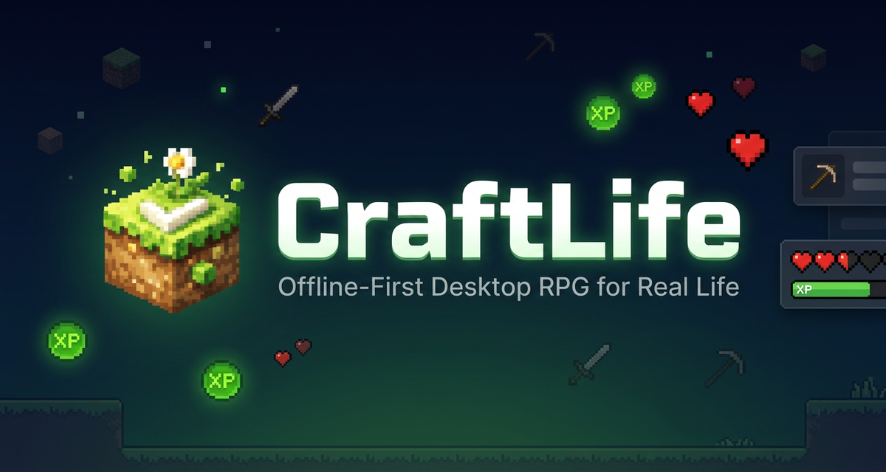
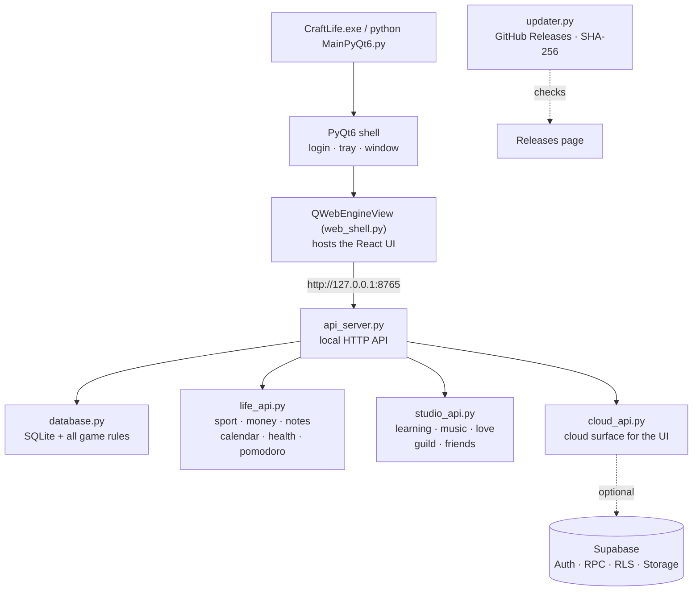

<div align="center">



# CraftLife

**An offline-first, Minecraft-themed RPG for real life — now on desktop, Android, and cloud sync.**

Habits, quests, bosses, pets, money, health, learning, and social features —
with your data in a local SQLite file you own.

[](https://github.com/Hellowww-02/CraftLife/releases/latest)
[](https://github.com/Hellowww-02/CraftLife/releases/latest)
[](requirements.txt)
[](https://github.com/Hellowww-02/CraftLife/actions/workflows/ci.yml)
[](LICENSE)

[Download](https://github.com/Hellowww-02/CraftLife/releases/latest) ·
[Features](#features) · [Getting started](#getting-started) ·
[Project structure](#project-structure) · [Docs](#documentation) ·
[Contributing](#contributing) · [Support](#support)

</div>

---

## About

CraftLife turns everyday productivity into a role-playing game. Complete habits to
earn XP and gold, level up your character, adopt pets, fight bosses, and manage a
full in-game economy — all themed around a blocky world you already know.

Everything local runs **100% offline**. An optional Supabase cloud adds multi-device
sync and online social features, but the app never requires it.

- **Local first** — one SQLite database, stored on your machine, updated in place.
- **No fake success** — online actions only complete after the server confirms.
- **Two languages** — every screen ships in Indonesian and English (4,637 strings).
- **29 pages** — a React UI inside a PyQt6 desktop shell, with the legacy Qt pages
  still available as a fallback.

## ✨ What's New in v1.7.4

| Area | Highlights |
|------|------------|
| 🎰 Pet gacha | Spin is now the ONLY way to get pets (pet purchases removed from the Shop) — 120 gold/spin, open odds (Common 34% → **Secret 2%**), pity Epic+@10 & Legendary+@30; duplicates convert to training EXP, owned pets never touched |
| 🐾 39 pets + arena | 25 pets rebalanced into rank tiers + 14 new (incl. 2 Secrets: 🐲 Void Dragon, 🦢 Luminara); Pokémon-style spotlight stage, spin machine, and a full encyclopedia with silhouettes |
| ⚡ Active pet skills | Legendary/Mythic/Secret only — cost user MP, per-rank cooldowns (30/20/15 min), power scales with pet level |
| 🍜 Food 874 → 1,074 | +100 foods & +100 drinks, bilingual names, factual macros, zero duplicates (auto-filtered against 1,361 existing names) |
| ⚒️ Enchant anvil | Enchanting now lives ONLY in the new **Forge** tab (manual enchant removed from the Shop inventory): Minecraft-anvil feel with hammer & sparks, exact buff preview per level; 28 items rebalanced onto a consistent cost/power curve |
| 🔨 Crafting table | Crafting page rebuilt as a Minecraft-style crafting table — wooden panels, beveled ingredient slots, animated forge arrow, pressable wood button with shake & pop on craft |
| 💡 Ambient LEDs | Perimeter ambient LED lighting around the app frame (side/bottom rails, corner accents, edge light-spill) — never overlaps content; three motion modes (breathe/chase/twinkle) with a unique signature per page × per theme, cursor-reactive nodes, event brightness waves, and an on/off switch in Settings |
| 📊 Social pages | Leaderboard top-3 podium, achievement category chips + claimable glow, staggered guild stat cards & friend rows |
| 🐛 Bug batch | Notes Collapse/Expand-all fixed + state checkpoint + folder search + bigger rows; chart tooltips no longer clip at max values; duplicate popups merged; 12-theme button contrast tokens |
| 🎁 Database | 3 new redeem codes (incl. `VOIDHATCH` → Secret pet) & 10 new achievements (74 total, id/en) |

## ✨ What's New in v1.7.2

| Area | Highlights |
|------|------------|
| 🖋️ Page signatures | All pages reconstructed with their own visual identity — SignatureKit emblems, display titles & unique pattern strips (peaks/grid/circuit/orbit/dots/wave); pure presentation, zero logic touched |
| 🎨 12 themes | 5 new identities (🌸 Sakura · 🏜️ Desert · 🌻 Sunflower · 👑 Royal · 🖤 Graphite), 7 reworked palettes, preview-card picker, smooth cross-fade on switch |
| 🐛 Gemini key fixed | Proper API-key dialog (PyQt6 WebEngine can't run window.prompt) + server status restore — chatbot & Studio keys survive page changes and restarts |
| 🗂️ Duplicate → folder | Duplicating a task card inside a folder keeps the copy in that folder (Habits · Dailies · Quests · Sport Track) — no more Ungrouped |
| 📝 Markdown rendered | Auto-updater release notes and Learning saved notes now render full markdown |
| 📈 Interactive charts | Every chart primitive (line · dual-line · bar · donut · heatmap · stacked bar) answers the cursor: tooltips with value+label, guide lines, focus dots, highlighted segments — live on Dashboard, Economy, Sport, Health & Food, Pomodoro & Love |
| ✋ Interactive everywhere | Buttons gain a hover sheen, dialogs fade-to-pop, task cards reveal & show reorder affordances, HP/MP/XP bars animate on change, Health & Food completes the signature set |

## ✨ What's New in v1.7.0

| Area | Highlights |
|------|------------|
| 📚 Learning Studio | All 12 generators get professional-grade prompts + new options (audience level, tone, examples toggle); quizzes carry sub-topics, flashcards carry hints & examples, slides carry speaker notes |
| 🗂️ Artifact history | The vertical list becomes a searchable dropdown (sort, type groups, rename/export/duplicate/delete) — the interactive preview gets full panel height |
| 🃏 Premium previews | 3D flashcard flip with shuffle + keyboard, quiz progress bar + jump chips + SVG score ring, slide viewer with speaker-notes panel |
| ⚔️ Guild Boss Arena | Rebuilt arena stage: tier-glow boss plate, animated HP bar, event-driven damage floats, hit shake, battle log — and a Pokémon-duel style message box for attack results (no more popups); zero game logic changed |
| 🛒 Shop | Item catalog grouped into category sub-tabs with counts (Weapon · Armor · Tool · Consumable · Legendary · Special) |
| ☁️ Cloud & Sync | New Configure Cloud dialog (Account · Sync · Devices · Diagnostics); Supabase errors mapped to structured bilingual guidance — the bare "HTTP 400" is gone |

## ✨ What's New in v1.6.7

| Area | Highlights |
|------|------------|
| ⚡ Performance | Per-view code splitting: initial JS 1,614 → 444 kB (−72%), each page loads on demand with the familiar skeleton |
| 🛡️ Crash safety | Bilingual error boundaries per view + root: a crashing page shows a recovery panel instead of a blank screen |
| 💰 Economy Budgets | New Budgets tab: monthly per-category limits with live spend tracking, On track / Almost over / Over budget states |
| 🍱 Nutrition | Favorite foods (star any item) plus a Recent filter with your last 10 logged foods |
| ✨ Polish | Esc closes all 47 dialogs, count-up hero numbers, `?` keyboard-shortcut help, Lucide icons replace structural emoji in headers |
| ⌨️ Command Palette | Full keyboard control (↑↓ + Enter, Ctrl+1–9 quick pages), grouped Pages/Actions sections, one-tap complete for Habits, Dailies & Quests |
| 🔔 Notifications | Restored navbar bell: unread badge, dropdown history, per-item and mark-all-read, Esc closes |
| 🎵 Music + ♿ a11y | Sleep timer (15/30/60 min) with live countdown and auto-pause; Tab focus trapped in all major dialogs |
| 🍱 Food & drink catalog | +100 items (50 regional foods, 50 drinks incl. single-origin coffees, jamu & wedang) — catalog now 874 entries; sortable grid (name/calories/protein) + ½×/1×/2× portion presets |

## ✨ What's New in v1.6.5

| Area | Highlights |
|------|------------|
| 🍱 Food database | Deduplicated catalog: 850 → 774 unique entries with zero duplicates; 9 nutrition corrections (kerupuk values are now per serving, not per 100 g); 33 new Indonesian snacks and drinks — kerupuk, ciki, street snacks, bottled drinks — each with Indonesian + English names and verified approximate macros |
| 🔄 Migration | Existing databases upgrade in place: old values sync to canonical, semantic duplicates merge automatically, and food logs plus custom foods are preserved untouched |

## ✨ What's New in v1.6.4

| Area | Highlights |
|------|------------|
| 📚 Learning | True 3-panel NotebookLM-style shell with draggable splitters and collapse; multi-file upload (23 types, drag-and-drop) with originals kept; website and YouTube sources with transcripts; 4 new Studio outputs (Briefing Doc, Data Table, Infographic, Slide Deck) with CSV/HTML export; KaTeX math in AI chat |
| ✅ Habits & date | Real fail streaks (counts no longer resurrect) with a done-today indicator; server-clock "today" that ticks and rolls over at midnight without a full reload |
| 🗄️ Database | Self-care: scheduled auto-cleanup independent of retention, per-table sizes, one-click checkpoint/VACUUM with before/after reports |
| 🔄 Updater | Auto-update that actually works: verified downloads with progress, release notes, countdown dialog, and a logged, abort-safe apply step |

## Features

**Character & dashboard** — Level, XP, HP, MP, gold, streaks, avatar classes,
talents, rebirth, titles, command palette (Ctrl+K), onboarding wizard, and a
Year Wrapped report in your own currency.

**Habits, dailies & quests** — Positive/negative habits with true streaks and a
done-today indicator, recurring dailies with fail and freeze, one-time quests,
folders, templates, drag-to-reorder with undo.

**Body** — Workout log with reps chart, a 1,074-item bilingual food
database with meals and macros, health logs (steps, sleep, weight, height,
mood) with 7-day trends, water goals, and a global Pomodoro timer with alarm.

**Money** — Income/expense tracking, debts with installments, savings,
investments, subscriptions, multi-currency display, and a supplies inventory.

**Notes & learning** — Notes with folders, archive, attachments, and LaTeX
preview. A NotebookLM-style learning space: 3-panel shell (sources, chat,
studio) with draggable splitters, 23-type multi-upload with originals kept,
website and YouTube sources, Gemini chat with source citations, quizzes,
flashcards, summaries, study guides, timelines, Briefing Doc, Data Table,
Infographic and Slide Deck outputs, and a two-host Audio Overview podcast.

**Music** — Local library with playlists and custom icons, downloads, a
cross-page mini player, and synced lyrics that follow the track — with scored
search, manual `.lrc`/`.txt` import, and export.

**Calendar & reminders** — Indonesian holidays (2025–2027), day notes, and
reminders with sounds, including yearly repeats (29 Feb safely lands on 28 Feb).

**RPG systems** — Shop and 10-slot equipment; a Minecraft-style crafting
table; enchanting on an interactive Forge anvil; pets obtained via spin gacha
(open odds + pity, 39 pets across six ranks incl. Secret, active skills,
training, buffs, encyclopedia); solo and guild boss battles; achievements;
redeem codes; and a leaderboard.

**Social** — Friends with full chat (attachments, replies, reactions),
couple link with a six-tab Love Space (overview, plans, memories, connection,
cycle, gallery), guilds with chat and bosses, PvP challenges, and a
notification center.

**Account & settings** — Local login with lockout protection, backup codes, and
optional app lock. Cloud link with explicit conflict resolution. Themes, font
scale, high contrast, sound toggle, an ambient-LED effects toggle, tracker
export/import, scheduled database self-care, and working in-app updates.

## Getting started

### For users (Windows)

1. Open the [latest release](https://github.com/Hellowww-02/CraftLife/releases/latest).
2. Download the release `.zip` and extract it anywhere.
3. Run `CraftLife.exe`.

Your data lives in `%APPDATA%\CraftLife\craftlife.db`, outside the app folder,
so updating never wipes it. Keep a backup anyway (Settings → Data).

Requirements: Windows 10+ x64. No internet needed except for cloud sync,
Gemini chat, podcast voices, and music downloads.

### For developers (from source)

```bash
git clone https://github.com/Hellowww-02/CraftLife.git
cd CraftLife

pip install -r requirements.txt

npm install        # root: npm workspaces links packages/craftlife-core + web
npm run build      # builds the shared core package, then the web UI
python MainPyQt6.py
```

Requirements: Python 3.10+, Node.js 18+ (only to build the UI).

The repository is an **npm workspace** (`packages/*` + `web`). Install once at the
root — never inside `web/`. The shared contracts live in
`packages/craftlife-core` and are linked automatically.

Useful modes:

| Mode | How |
|------|-----|
| Normal (built UI served by the API) | `python MainPyQt6.py` after `npm run build` |
| UI hot reload during development | `python api_server.py` + `cd web && npm run dev` (Vite on `:3000`, API on `:8765`) |
| Legacy Qt pages instead of the web UI | `CRAFTLIFE_WEB_UI=0` |
| Custom API port | `CRAFTLIFE_API_PORT=8899` |

Sanity checks after changing code:

```bash
python3 scripts/verify_gates.py     # all §7 verification gates, one command
```

That single command runs the whole gate table — Python syntax, TypeScript, the
Vite build (with asset hash + size), i18n parity, the database harnesses against
a fresh **and** a legacy database, the live API contract tests, the sync engine
and conflict harnesses, the frontend unit tests, a live smoke test, the cleanup
checks, the version anchors, and the no-secrets rule. See
[Testing](#testing) and `scripts/verify_gates.py --list`.

Running the pieces by hand:

```bash
python -m py_compile MainPyQt6.py database.py api_server.py life_api.py studio_api.py cloud_api.py web_shell.py updater.py
npm run typecheck   # core tsc --noEmit, then web tsc --noEmit
cd web && npm run build
```

`npm run typecheck` runs `tsc --noEmit` in `packages/craftlife-core` and then in
`web`; both must report 0 errors. The build must produce `web/dist/index.html`.

## Testing

The suite was established by milestone M02 (roadmap K20: no refactor starts
until a test suite exists to catch the regressions a refactor causes) and
extended by M03.

```bash
npm run test:py     # Python:  484 tests (stdlib unittest, no extra dependency)
npm run test        # Frontend: 116 tests (vitest, core + web)
npm run test:all    # both
python3 scripts/verify_gates.py   # both + every §7 gate
```

| Area | Tests | Covers |
|------|-------|--------|
| `tests/test_database_schema.py` | 19 | Fresh-database schema, indexes, `integrity_check`, FK violations, seeds, idempotency — plus that `PRAGMA foreign_keys` is genuinely ON for the pooled connection and `ON DELETE CASCADE` runs |
| `tests/test_database_legacy.py` | 16 | Legacy→current migration with rows preserved (§6) |
| `tests/test_m03_sync_schema.py` | 27 | M03 row-level sync prerequisites: `uuid`/`rev`/`updated_at`/`deleted_at` on all 41 synced tables, unique + never NULL, trigger-filled, legacy migration on a populated database, and the guards pinning why G10 is still open |
| `tests/test_m04_channel_a.py` | 20 | M04a append-only channel: the 7-table allowlist, append batches, drain order, no duplicates on replay |
| `tests/test_m04_channel_b.py` | 33 | M04b row-level merge (pure function), `updated_at` and tombstone triggers on all 41 tables, tombstone/GC lifecycle, `recipe_items` ownership, and that the acknowledged `rev` becomes the next `base_rev` |
| `tests/test_m04c.py` | 23 | M04c sync status and the recoverable conflict surface: conflicts recorded with both values, one field restorable without moving the row, `_sync_out` no longer recurses |
| `tests/test_sync_engine.py` | 17 | Sync queue: dedup, ordering, exponential backoff, retry, per-user scoping |
| `tests/test_sync_conflict.py` | 7 | Two-device snapshot conflict; the M04 `xfail` was removed once both channels landed |
| `tests/test_api_contract.py` | 11 | A live `api_server` on a real socket: auth, response shapes, routes, i18n |
| `tests/test_api_routes.py` | 11 | Every `/api/...` path the web client calls is dispatched by the server |
| `tests/test_i18n.py` | 9 | Bilingual catalogue integrity (P7) |
| `test_cloud_backup.py` | 24 | Cloud tracker backup: the snapshot must carry all 40 export tables (an incomplete one is rejected on restore), an admin must still get a backup even though a plain export refuses them, restore must make a local backup before overwriting, and a path from the request must be refused unless it is inside the caller's own folder |
| `test_data_maintenance.py` | 42 | The Data Maintenance feature, tested as the three promises its own UI makes: a backup file must really exist on disk, master data (habits/food/water/economy/notes) must survive, and history inside the retention window must survive. Plus every retention/schedule option the UI offers, and the auto-purge trigger pinned to its single caller |
| `test_m05d_store.py` | 19 | M05d storage boundary, pinned by AST: `cloud_api.py` must hold zero references to `database`. Plus the proof the layer is real rather than indirection - a second in-memory implementation serves the cloud handlers without SQLite and without editing the domain. Signature parity keeps the interface from going stale against `database.py` |
| `test_m05c_rules_guard.py` | 27 | M05c token bucket: burst, refill rate, per-key independence, bounded memory, and a 16-thread test that fails if the bucket over-admits. Plus the audit-log contract, pinned structurally: the schema has no column that could hold a request body |
| `test_m05c_api_guard.py` | 13 | The M05c wiring over a live socket: 429 + Retry-After, unauthenticated floods limited, `/api/health` exempt, `dbPath` hidden, `/api/admin/debug` gone in strict mode but still working on desktop, mutating requests audited, successful GETs not |
| `test_m05b_tenant_scoping.py` | 7 | M05b cross-tenant scoping: every `user_id` table is seeded with a sentinel row for user B, then all 301 client GET routes are called as user A and scanned for it. Pins a coverage floor so the sweep cannot silently shrink, and prints the tables it could not seed |
| `test_m05a_rules_auth.py` | 35 | M05a JWT verification as attack vectors: alg-confusion, tampered payload, expiry/nbf/iss/aud, empty secret never verifies, error messages never leak the secret, and per-request identity via ContextVar |
| `test_m05a_api_auth.py` | 12 | The M05 acceptance criteria against a live socket: no/invalid/expired/unlinked JWT → 401, user A never sees user B's habits, `/api/health` stays public, and desktop behaviour is unchanged with strict off |
| `packages/craftlife-core/src/utils/__tests__/` | 33 | `currency.ts` (money rules) and `serverClock.ts` (daily-reset date key) |
| `web/src/**/__tests__/` | 83 | `shellState.ts` (layout + preference migration) and `cycleUtils.ts` (cycle calendar maths) |

The legacy harness reconstructs the schema of the oldest `database.py` in this
repository (commit `be3e2f6`) rather than shipping a fixture, because user
databases must never be committed. To run it against a **real** archive:

```bash
CRAFTLIFE_LEGACY_DB=/path/to/craftlife.db python3 -m unittest tests.test_database_legacy -v
```

Without that variable those tests skip loudly, and a self-test asserts the skip
is explicit — the gap is visible in CI output instead of looking green.

CI (`.github/workflows/ci.yml`) runs the same runner on every push and pull
request to `main`, and fails if `package-lock.json` is out of date or if any
gate modified a tracked file. Full details, including known gaps, are in
[`tests/README.md`](tests/README.md).

## Configuration

All settings live inside the app. The only file you may need to touch is `.env`,
placed next to the sources (or next to `CraftLife.exe` for installed copies):

```ini
SUPABASE_URL=https://xyzcompany.supabase.co
SUPABASE_PUBLISHABLE_KEY=sb_publishable_...
CRAFTLIFE_CLOUD_ENABLED=1
CRAFTLIFE_SYNC_INTERVAL_SECONDS=300
```

Copy `.env.example` to `.env` and fill in your own values. Without a `.env`, the
app runs fully offline and cloud features simply report "not configured". Never
commit your `.env`, and never ship one inside a release archive. Only the
publishable key belongs in a client — a service-role key must never be included
anywhere.

Feature flags used by the app:

| Variable | Default | Purpose |
|----------|---------|---------|
| `CRAFTLIFE_MUSIC_LIB_LIMIT` | `500` | Max files listed by `/api/music/library` |
| `CRAFTLIFE_API_PORT` | `8765` | Port of the local API |
| `CRAFTLIFE_WEB_UI` | `1` | `0` falls back to the legacy Qt pages |
| `CRAFTLIFE_WEB_LOGIN` | `0` | `1` shows the web login screen |

## Architecture



Design rules the codebase follows:

- Game logic lives in `database.py` only — the React UI never reimplements it.
- Money is formatted through `currency.ts` in `@craftlife/core`; dates follow the
  server clock (`serverClock.ts`), not the browser clock.
- The UI talks to the local API only. It never contacts Supabase directly, so no
  secret key can leak into the web bundle.
- Schema changes are idempotent (`_safe_alter` in `init_db()`): fresh and
  existing databases end up identical, and user data is never dropped.

## Project structure

```text
CraftLife/
├── MainPyQt6.py          Desktop shell + legacy Qt pages
├── web_shell.py          QWebEngineView host, download manager
├── api_server.py         Local HTTP API (127.0.0.1:8765)
├── life_api.py           Sport, money, notes, calendar, health, pomodoro
├── studio_api.py         Learning, music, love, guild, friends, notifications
├── cloud_api.py          Cloud HTTP surface for the UI
├── cloud_service.py      Supabase client · sync_service.py · cloud_config.py
├── database.py           SQLite schema + all game logic (single source of truth)
├── translations.py       UI strings, Indonesian + English (4,637 keys)
├── updater.py            Auto-update from GitHub Releases (v1.7.4, SHA-256)
├── learning_helper.py    Gemini prompts and Studio parameters
├── music_downloader.py   Download engine (yt-dlp)
├── mathtools.py          Math text and LaTeX conversion
├── food_data.py          Food database · holidays.py + holidays_2025/26/27.json
├── applog.py             Logging helper
├── CraftLife.spec        PyInstaller spec (onedir, web/dist embedded)
├── requirements.txt      Python dependencies
├── package.json          npm workspace root (packages/* + web) + Supabase CLI tooling
├── tsconfig.base.json    Shared TS compiler options for every TS project
├── packages/
│   └── craftlife-core/   @craftlife/core — shared contracts (single source of truth)
│       ├── src/types.ts          Domain types (interfaces + type aliases)
│       ├── src/utils/            currency · serverClock · serverTime
│       ├── src/api/client.ts     HTTP client contract (apiBase, apiGet, apiPost, …)
│       └── src/i18n/messages.json  Generated catalogue (do not edit by hand)
├── icons/craftlife.ico   App icon
├── scripts/
│   ├── build.ps1         Windows release build
│   ├── build_windows.md  Build notes
│   ├── export_i18n.py    translations.py -> craftlife-core + web/public i18n JSON
│   ├── export_design_tokens.py  db.THEMES + index.css -> design/tokens.json (M06)
│   ├── verify_gates.py   All §7 verification gates + tests, one command (used by CI)
│   └── copy_qtwebengine.py  QtWebEngine helper (rarely needed)
├── tests/                Python suite (484 tests) + harnesses + README
├── .github/workflows/    ci.yml — runs scripts/verify_gates.py on push & PR
├── ../CraftLife-Android/  Android client (M07) — SEPARATE folder on purpose,
│                          consumes @craftlife/core via a file: dependency.
│                          Not part of this repo: different toolchain, release
│                          pipeline and cadence. Verified by the `types-mobile`
│                          gate, which reaches across to the sibling folder.
├── web/                  React 18 + Vite 5 + Tailwind 4 + TypeScript UI (29 pages)
│   ├── src/components/views/  One file per page + Login + Onboarding
│   ├── src/components/   Shared UI, learning, love, music, notes, wrapped parts
│   ├── src/context/GameContext.tsx  Global app state
│   ├── src/api/          Typed route wrappers (life, studio, rpg, cloud)
│   ├── src/utils/        theme, sound, pomoAlarm
│   └── public/i18n/      Runtime messages.json served over HTTP (generated)
├── DESIGN.md             Visual contract for web + Android (M06, K24)
├── supabase/             16 migrations + attachment-maintenance function + tests
└── *.md                  This file plus roadmaps and reports (see below)
```

## Shared contracts (`@craftlife/core`)

`packages/craftlife-core` holds the TypeScript contracts that every CraftLife
client must share, so there is exactly **one** implementation of each
(`UPDATE_RULES.md` P2):

| Export | Purpose |
|--------|---------|
| `types.ts` | Domain types — interfaces and type aliases only, no runtime code |
| `utils/currency.ts` | The one money formatter (`formatMoney`, `currencySymbol`, `fromIdr`, …) |
| `utils/serverClock.ts` · `utils/serverTime.ts` | Server-clock date handling — streaks and daily resets follow the server clock, never `new Date()` |
| `api/client.ts` | HTTP client contract (`apiBase`, `apiGet`, `apiPost`, `apiUploadFile`, …) |
| `i18n/messages.json` | Generated 4,637-key × 2-language catalogue |

Consuming it:

```ts
import { formatMoney, apiGet, type TaskDifficulty } from "@craftlife/core";
```

Two resolution paths, deliberately:

- **In-repo (`web`)** resolves to the package **source** via `tsconfig` `paths`
  and a Vite alias, so `npx tsc --noEmit` and `npx vite build` stay standalone —
  no requirement to build `dist` first.
- **External consumers** resolve to the compiled `dist/` through the package
  `exports` map. Build it with `npm run build --workspace @craftlife/core`.

`web/public/i18n/messages.json` remains a runtime asset fetched over HTTP by
`web/src/i18n.ts`; `scripts/export_i18n.py` regenerates both copies from
`translations.py`, which stays the single source of truth.

## Documentation

Design docs and phase reports kept in the repo:

| Document | Contents |
|----------|----------|
| [UPDATE_RULES.md](UPDATE_RULES.md) | How update sessions are run (process reference) |
| [tests/README.md](tests/README.md) | Test suite guide — harnesses, how to run, CI, known gaps |
| [UPDATE_ROADMAP_A01_A14_v1.6.3.md](UPDATE_ROADMAP_A01_A14_v1.6.3.md) | v1.6.3 plan with per-phase evidence |
| [UPDATE_ROADMAP_C01_C09_v1.6.4.md](UPDATE_ROADMAP_C01_C09_v1.6.4.md) | v1.6.4 plan with per-phase evidence |
| [OPERATOR_RELEASE_v1.6.4.md](OPERATOR_RELEASE_v1.6.4.md) | Release operator runbook (build → zip → tag → publish → verify) |
| [RELEASE_NOTES_v1.6.4.md](RELEASE_NOTES_v1.6.4.md) | v1.6.4 GitHub Release notes |
| [RELEASE_NOTES_v1.6.5.md](RELEASE_NOTES_v1.6.5.md) | v1.6.5 GitHub Release notes |
| [RELEASE_NOTES_v1.6.7.md](RELEASE_NOTES_v1.6.7.md) | v1.6.7 GitHub Release notes |
| [RELEASE_NOTES_v1.7.2.md](RELEASE_NOTES_v1.7.2.md) | v1.7.2 GitHub Release notes |
| [RELEASE_NOTES_v1.7.4.md](RELEASE_NOTES_v1.7.4.md) | v1.7.4 GitHub Release notes |
| [UPDATE_ROADMAP_I01_I07_v1.7.2.md](UPDATE_ROADMAP_I01_I07_v1.7.2.md) | v1.7.2 plan (I01–I07) |
| [UPDATE_ROADMAP_L01_L10_v1.7.4.md](UPDATE_ROADMAP_L01_L10_v1.7.4.md) | v1.7.4 plan (L01–L10) |
| [OPERATOR_RELEASE_v1.7.4.md](OPERATOR_RELEASE_v1.7.4.md) | v1.7.4 release operator runbook |
| [RELEASE_NOTES_v1.7.0.md](RELEASE_NOTES_v1.7.0.md) | v1.7.0 GitHub Release notes |
| [UPDATE_ROADMAP_H01_H07_v1.7.0.md](UPDATE_ROADMAP_H01_H07_v1.7.0.md) | v1.7.0 plan (H01–H07) |
| [2026-09-23-C01-C09-PHASE-SUMMARY.md](2026-09-23-C01-C09-PHASE-SUMMARY.md) | v1.6.4 consolidated phase report |
| [UPDATE_ROADMAP_P47_P63.md](UPDATE_ROADMAP_P47_P63.md) | v1.6.0 fix roadmap |
| [2026-09-08-P47-P63-PHASE-SUMMARY.md](2026-09-08-P47-P63-PHASE-SUMMARY.md) | v1.6.0 consolidated phase report |
| [2026-09-11-P63-finalize-v1.6.0.md](2026-09-11-P63-finalize-v1.6.0.md) | v1.6.0 release log |
| [PARITY_ROADMAP_P30_P46.md](PARITY_ROADMAP_P30_P46.md) | Phase-4 parity roadmap |
| [CRAFTLIFE-PARITY-REPORT.md](CRAFTLIFE-PARITY-REPORT.md) | Cumulative parity report (P1–P19) |
| [<CRAFTLIFE PHASE 3 FINAL PARITY REPORT.md>](<CRAFTLIFE PHASE 3 FINAL PARITY REPORT.md>) | Phase-3 parity report (P22–P29) |
| [FINAL-PARITY-MATRIX.md](FINAL-PARITY-MATRIX.md) | Page-by-page parity matrix |
| [UIUX_ROADMAP_U1_U12.md](UIUX_ROADMAP_U1_U12.md) | UI v2 "Craft Design System" roadmap |

## Data & storage

| Setup | Database location |
|-------|-------------------|
| From source | `craftlife.db` next to the sources |
| Installed exe | `%APPDATA%\CraftLife\craftlife.db` |

Settings → Data can export and re-import your tracker data. Release archives
never contain a database or a `.env`.

## Security & privacy

- Local passwords use PBKDF2-HMAC-SHA256 with salt, plus lockout, backup codes,
  and an optional app lock. Cloud refresh tokens use the OS keyring.
- Cloud traffic goes over TLS with Supabase Auth and row-level security;
  storage buckets are private.
- Your Gemini key (optional, for Learning) is stored locally and never sent to
  the cloud snapshot or the web bundle.
- Direct chat is not end-to-end encrypted.
- Health and cycle tools are personal trackers, not medical devices.

## Building a release (maintainers)

From the repo root in PowerShell 5.1:

```powershell
powershell -ExecutionPolicy Bypass -File .\scripts\build.ps1
```

The script regenerates the web i18n files, builds the UI, runs PyInstaller, and
places the result in `dist\CraftLife\`. Do not use `--optimize 2` or `--strip`
(the AI SDK crashes on missing docstrings).

To ship an auto-update (full runbook:
[OPERATOR_RELEASE_v1.7.4.md](OPERATOR_RELEASE_v1.7.4.md)):

1. Zip the **contents** of `dist\CraftLife\` (no `.env`, no `craftlife.db*`).
2. Draft a GitHub Release with a tag newer than `APP_VERSION`, attach the zip
   (plus a SHA-256 checksum), and publish.
3. Clients pick it up from `/releases/latest` and apply it on restart.

## Troubleshooting

| Symptom | Fix |
|---------|-----|
| Blank page / "React UI has not been built" | `npm install` at the repo root, then `npm run build` |
| `ERR_CONNECTION_REFUSED` on `:3000` | Use the API port `8765` in production; `:3000` is dev-only |
| Cloud shows "not configured" | Put `.env` beside the exe/sources, then restart |
| `PGRST205` on profiles | Supabase migrations have not been applied yet |
| `QtWebEngineProcess.exe` missing | `pip install PyQt6-WebEngine` and rebuild |
| Database locked | Run only one CraftLife process at a time |
| Update applied but version unchanged | The archive had the wrong layout — copy the **contents** of `dist\CraftLife\` over the app folder without touching `craftlife.db*` / `.env` |

## Changelog

Full notes live on the [Releases page](https://github.com/Hellowww-02/CraftLife/releases).

- **v1.7.4 "Spin & Spectrum"** (3–4 Oct 2026) — Content & feel:
  pets become a full gacha system and the ONLY pet path (spin with open
  odds + pity, 39 pets incl. 2 Secrets, active skills, Pokémon-style
  arena + encyclopedia; pet purchases removed from the Shop), food
  database grows 874 → 1,074, enchanting moves entirely to an
  interactive Minecraft-style anvil (28 items rebalanced; manual shop
  enchant removed), the app frame gains perimeter ambient LED lighting
  (breathe/chase/twinkle signatures per page × 12 themes,
  cursor-reactive nodes, event brightness waves, Settings toggle), the
  Crafting page becomes a Minecraft-style crafting table, social pages
  become interactive (podium, chips, stagger), plus a bug batch (notes
  folders, chart tooltips, duplicate popups, theme contrast) and a full
  i18n sweep (4,613 keys). 3 new redeem codes & 10 new achievements.
  Shipped with in-release revisions rev-B (crafting table, FX toggle,
  single-path Shop) and rev-C (perimeter LED fix).
- **v1.7.2 "Signature & Spectrum"** (29 Sep 2026) — UI/UX
  reconstruction: every page gets its own visual signature (SignatureKit +
  `.ct-sig-*` toolkit), theme catalog grows 7 → 12 (five new identities,
  seven reworked palettes, preview-card picker with smooth cross-fade),
  Gemini API key finally persists via a proper dialog + server restore,
  task duplicates land in the active folder, and release notes / saved
  notes render full markdown. i18n 4,535 keys (+7). Zero features removed.
- **v1.7.0 "Arena & Clarity"** (28 Sep 2026) — Learning Studio quality
  upgrade (stronger prompts + audience/tone/examples options; dropdown
  artifact history; 3D flashcards, quiz score ring, slide speaker notes),
  Guild Boss Arena reconstruction with a Pokémon-duel style in-arena
  message box replacing the attack-result popup, shop category sub-tabs,
  and a professional Cloud configuration dialog that ends the bare
  "HTTP 400" errors. i18n 4,528 keys (+74). Zero features removed.

- **v1.6.7 "Performance & Polish"** (25 Sep 2026) — Per-view code splitting
  (−72% initial JS), bilingual crash recovery, Economy Budgets tab, food
  favorites + recent, Esc for all 47 dialogs, count-up numbers, shortcut
  help, Lucide header icons, palette keyboard nav + task actions, a
  notification center, a music sleep timer, dialog focus traps, +100
  foods & drinks (catalog 874), sortable nutrition grid, and portion
  presets. Zero features removed.
- **v1.6.5 "Food Database Update"** (23 Sep 2026) — Deduplicated food
  catalog (850 → 774, zero duplicates), 9 nutrition corrections, 33 new
  Indonesian snacks and drinks with EN translations, and an in-place
  migration that preserves food logs and custom foods.
- **v1.6.4 "Study & Stability"** (23 Sep 2026) — NotebookLM-style Learning
  shell, 23-type multi-upload, URL/YouTube sources, 4 new Studio outputs, KaTeX
  math; real habit fail streaks; ticking server-clock date with midnight
  rollover; database self-care; and an auto-updater that actually works.
- **v1.6.3 "Quality of Life+"** (16 Sep 2026) — Lyrics follow the track, scored
  lyric search, documented lyric import; download/export overhaul; Learning with
  answerable quizzes, per-generator dialogs, artifact list, NotebookLM-style
  shell, citations, two-host Audio Overview; six polished Love Space tabs with
  Special Days and yearly reminders; Year Wrapped in the user's currency.
- **v1.6.0 "Quality of Life"** (11 Sep 2026) — 17 requested fixes including
  redeem codes, single-send AI chat, global music engine, playlist icons,
  couple tracking, and monthly database cleanup.
- **v1.5.0** — UI v2: the full "Craft Design System" rebuild of the web UI.
- **v1.4.0 "Full Parity Release"** — Complete PyQt → React feature parity,
  server clock, auto-update from GitHub Releases.

## Roadmap

- 🚧 Android + cloud sync migration (M01–M14): M01–M14 selesai: v2.0.0 "Three Platforms, One Life" (parity di VERIFIKASI_M12.md, QA di QA_M13.md, rilis di RELEASE_NOTES_v2.0.0.md; bukti perangkat fisik diverifikasi pengguna pasca-rilis).
  (Offline & reliabilitas): plafon 8 MB snapshot dihapus lewat payload
  part inkremental (G5 tertutup), backoff ber-jitter, cache Android
  berpagar, dan Recovery UI di Settings. Berikutnya M14 (Rilis v2.0.0).
  Pengguna lokal tidak berubah.
- ✅ Commit Phase C (C01–C09) — v1.6.4 "Study & Stability" (Learning · Database
  & Updater · Date Utilities).
- Closed-app push notifications, attachment malware scanning, deeper anti-cheat
  for server-scored features, Linux/macOS packaging.
- Cloud-side: applying migrations live, scheduled attachment purge.

## Contributing

Pull requests are welcome:

1. Fork, clone, and branch off (`feature/short-name`).
2. Keep game logic in `database.py` — never duplicate it in TypeScript.
3. Add UI strings in both Indonesian and English (`translations.py`, then
   `python scripts/export_i18n.py`).
4. `py_compile`, `tsc --noEmit`, and `vite build` must all pass.
5. Never commit secrets, `.env` files, or databases.

## License

[MIT](LICENSE) © 2026 CraftLife — provided "AS IS", without warranty.

Minecraft and other marks belong to their respective owners. CraftLife is an
independent project, not affiliated with Mojang or Microsoft.

## Support

Issues: [github.com/Hellowww-02/CraftLife/issues](https://github.com/Hellowww-02/CraftLife/issues)

Please include your OS, CraftLife version, source vs exe, local vs cloud, and
the exact error. Never attach `.env`, `craftlife.db`, or API keys.

---

<div align="center">

**Complete real quests. Keep your data. Level up your life.**

*CraftLife v1.7.4 — "Spin & Spectrum"*

</div>
